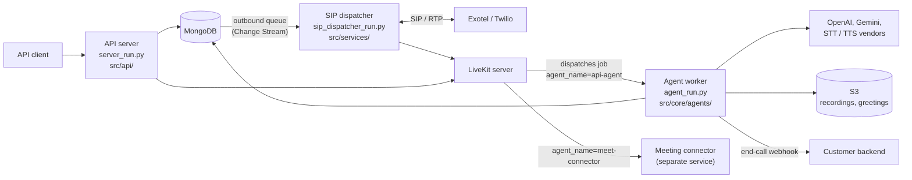
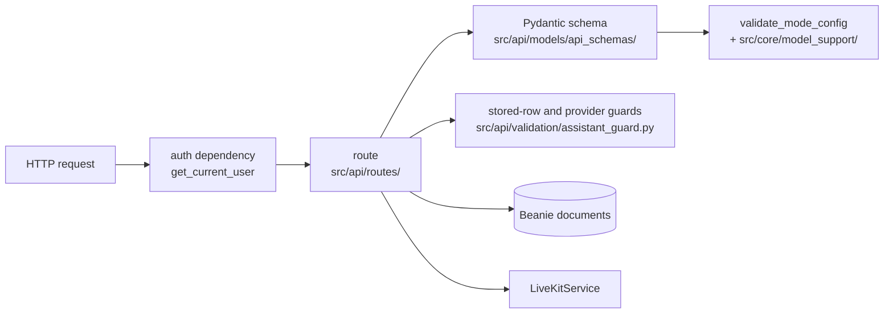
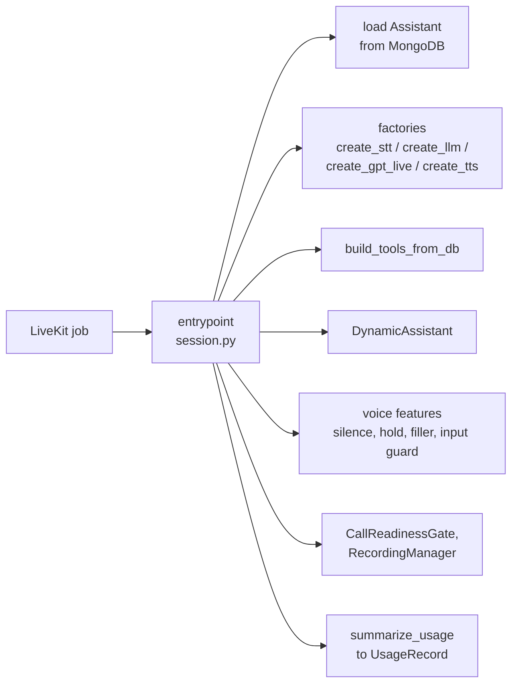

# Architecture

The user's view of the same system, with no code: [How it works](../docs/concepts/index.md)
(public). This page goes one level deeper and names the code behind each box.

## Processes and stores

Three processes share one package (`src/`) and one MongoDB.

| Process | Entry point | Job |
|---|---|---|
| API server | `server_run.py` | REST API, validation, queues outbound calls, starts web and meeting calls directly, serves the docs site and the docs MCP at `/mcp` |
| SIP dispatcher | `sip_dispatcher_run.py` | Exotel inbound SIP listener and outbound dispatch loop. Exactly one per deployment. In development the API runs both in-process (`ENABLE_SIP_LISTENER`, `ENABLE_DISPATCHER`). |
| Agent worker | `agent_run.py` | Registers with LiveKit as `api-agent` and runs one conversation per job |

Where each runs in production: [Deployment](operations/deployment.md).

## Inside each process

### API server

- `src/api/server.py` builds the FastAPI app, mounts one router per resource from
  `src/api/routes/`, installs the error handlers that redact secrets, and in `lifespan` connects
  MongoDB and optionally starts the SIP listener and dispatcher.
- Request bodies are Pydantic models in `src/api/models/api_schemas/` (`assistant.py`, `config/`,
  `telephony/`, `meeting.py`, `tools.py`, `keys.py`). The create and update validators call
  `validate_mode_config`.
- Guards that need the stored row or a call to OpenAI live in `src/api/validation/assistant_guard.py`.
- Routes talk to LiveKit through `LiveKitService` (`src/services/livekit/livekit_svc.py`), which
  also finalizes calls and sends the end-call webhook.
- `src/api/mcp_docs.py` serves the public docs over MCP.

### SIP dispatcher

- `outbound_dispatcher_loop` (`src/services/outbound_dispatcher/dispatcher.py`) wakes on a
  MongoDB Change Stream (with a safety-net poll), reserves capacity per call-type bucket, creates
  the room, dispatches `api-agent`, and places the call through Twilio or the Exotel bridge.
- `ensure_inbound_server` (`src/services/exotel/custom_sip_reach/inbound_listener.py`) receives
  Exotel INVITEs.
- Each Exotel call's media runs in its own process: `run_bridge` (`bridge.py`, started through `_bridge_subprocess_entry`) for outbound,
  `inbound_bridge_subprocess_entry` (`inbound_worker.py`) for inbound, both started from the
  context `get_bridge_context` returns. `RTPMediaBridge` (`rtp_bridge.py`) moves audio between RTP
  and a LiveKit track; `PortPool` hands out RTP ports.

Details: [Dispatcher and queue](subsystems/dispatcher-and-queue.md),
[Telephony (Exotel)](subsystems/telephony-exotel.md).

### Agent worker

- `agent_run.py` builds the `AgentServer` (`server`) from `WorkerOptions`, with `_worker_load`
  counting the worker's own jobs against `MAX_CONCURRENT_SESSIONS`.
- `entrypoint` (`src/core/agents/session.py`) resolves the assistant, builds the session for its
  mode, attaches voice features, runs the call, and finalizes it.
- Factories: `src/core/agents/stt/factory.py` (`resolve_stt`, `create_stt`),
  `src/core/agents/llm/factory.py` (`create_llm`, `create_gpt_live`),
  `src/core/agents/tts/factory.py` (`create_tts`). Pipeline and realtime build their
  `RealtimeModel` inline in `session.py`.
- `DynamicAssistant` (`src/core/agents/dynamic_assistant.py`) is the `Agent` subclass;
  `build_tools_from_db` (`src/core/agents/tool_builder.py`) turns stored tools into function tools.
- `src/core/agents/voice_features.py`: `SilenceWatchdogController`, `HoldController`,
  `InputGuardController`, `FillerController`.
- `src/core/agents/session_lifecycle.py`: `CallReadinessGate` (do not speak before the call is
  answered) and `RecordingManager` (egress).
- `src/core/agents/usage.py` folds `session.usage` into a `UsageRecord`.

Details: [Agent session](subsystems/agent-session.md),
[Speech and LLM stages](subsystems/speech-and-llm-stages.md),
[Usage and pricing](subsystems/usage-and-pricing.md).

### Shared code

`src/core/` is imported by every process: `config.py` (the only module reading the environment),
`db/` (Beanie documents), `call_types.py`, `billing.py`, `pricing/`, `providers/` (key masking and
`redact_text`), and `model_support/`.

## Where configuration is decided

Two packages exist so that a bad configuration cannot reach a call. Read them before the rest.

| Package | Holds |
|---|---|
| `src/core/model_support/` | **What each model and provider accepts.** Model sets per mode, which generation knob each model reads, the `service_tier` matrix, STT/TTS model sets, the Sarvam speaker roster, the Responses request body the runtime builds (`payload.py`), and one tool document to one OpenAI function schema (`tool_schema.py`). Deliberately **dependency-free**: the control image has no `livekit-agents` and the agent image has no FastAPI, so both import it and the two halves cannot disagree about which configs are legal. |
| `src/api/validation/` | **Guards that need more than the request.** Rules re-checked against the stored row (`enforce_stored_mode_constraints`: a PATCH naming one field can still make an assistant unrunnable) and the two that ask the provider (does it still serve this model; will it accept this exact request), in `enforce_openai_config`. |

The full chain of four gates: [Validation and model support](subsystems/validation-and-models.md).
What each gate catches, for users: [Compatibility matrix](../docs/reference/compatibility.md); the
silent-call failure it prevents and how to diagnose it:
[Troubleshooting](../docs/reference/troubleshooting.md).

## Subsystems

| Page | Covers |
|---|---|
| [Agent session](subsystems/agent-session.md) | Worker startup, how each assistant mode is built, voice features, transcription paths |
| [Speech and LLM stages](subsystems/speech-and-llm-stages.md) | STT, LLM and TTS factories, cascade stages, turn detection, per-stage usage |
| [Dispatcher and queue](subsystems/dispatcher-and-queue.md) | Outbound queue, dispatch loop, capacity caps, recovery |
| [Telephony (Exotel)](subsystems/telephony-exotel.md) | SIP/RTP bridge, inbound routing, audio pipeline, hold detection |
| [Meeting calls](subsystems/meeting-calls.md) | Two-job dispatch, audio flow, readiness, ownership |
| [Validation and model support](subsystems/validation-and-models.md) | The four config gates, `model_support/`, the per-mode rule table |
| [Usage and pricing](subsystems/usage-and-pricing.md) | How usage is collected, folded and priced |

Building a component the platform expects but does not ship (the meeting connector):
[Build a meeting connector](../docs/guides/meeting-connector.md).

## Where in the code

| What | File | Symbol |
|---|---|---|
| App, routers, lifespan | `src/api/server.py` | `app`, `lifespan` |
| Auth | `src/api/dependencies/auth.py` | `get_current_user`, `get_super_admin` |
| Per-mode rule table | `src/api/models/api_schemas/config/llm_config.py` | `validate_mode_config` |
| Assistant schemas | `src/api/models/api_schemas/assistant.py` | `CreateAssistant`, `UpdateAssistant` |
| Stored-row and provider guards | `src/api/validation/assistant_guard.py` | `enforce_stored_mode_constraints`, `enforce_openai_config`, `enforce_provider_keys`, `enforce_tool_change` |
| LiveKit calls, finalization, webhook | `src/services/livekit/livekit_svc.py` | `LiveKitService` |
| Dispatch loop and capacity | `src/services/outbound_dispatcher/dispatcher.py` | `outbound_dispatcher_loop`, `try_reserve_slot`, `get_bridge_context` |
| Exotel inbound listener | `src/services/exotel/custom_sip_reach/inbound_listener.py` | `ensure_inbound_server` |
| Exotel media bridges | `src/services/exotel/custom_sip_reach/` | `run_bridge`, `inbound_bridge_subprocess_entry`, `RTPMediaBridge`, `PortPool` |
| Worker options | `agent_run.py` | `server`, `_worker_load` |
| Job handler | `src/core/agents/session.py` | `entrypoint` |
| Factories | `src/core/agents/{stt,llm,tts}/factory.py` | `create_stt`, `resolve_stt`, `create_llm`, `create_gpt_live`, `create_tts` |
| Agent class, tools | `src/core/agents/dynamic_assistant.py`, `tool_builder.py` | `DynamicAssistant`, `build_tools_from_db` |
| Voice features | `src/core/agents/voice_features.py` | `SilenceWatchdogController`, `HoldController`, `InputGuardController`, `FillerController` |
| Call gate and recording | `src/core/agents/session_lifecycle.py` | `CallReadinessGate`, `RecordingManager` |
| Usage folding | `src/core/agents/usage.py` | `summarize_usage` |
| Model rules | `src/core/model_support/` | `capabilities.py`, `speech.py`, `openai_live.py`, `payload.py`, `tool_schema.py` |
| Documents | `src/core/db/db_schemas.py` | Beanie documents |
| Settings | `src/core/config.py` | `Settings` |
