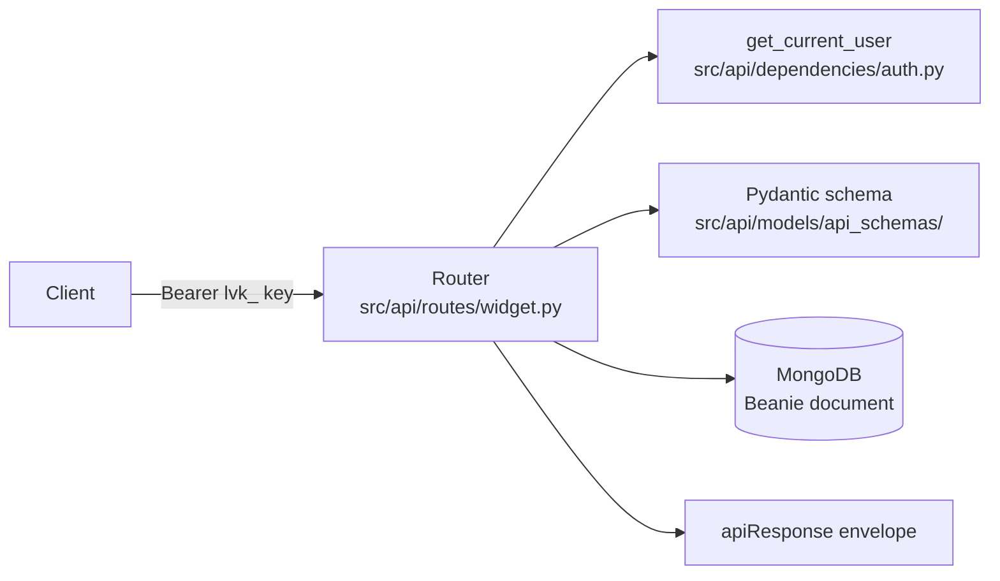

# Add an endpoint

This recipe adds a REST route to the API server (the control plane, `src/api/`). The example adds
`GET /widget/{widget_id}` for an imaginary `widget` resource; replace the names.



Layering rule: `src/api/` may import `src/core/` and `src/services/`; nothing outside `src/api/`
imports from it. The agent image has no FastAPI.

## 1. Pick the router

One router per resource, in `src/api/routes/<resource>.py`. If the route belongs to an existing
resource, add it there. For a new resource, create the file with:

```python
from fastapi import APIRouter, Depends, HTTPException

from src.api.dependencies import get_current_user
from src.api.models.response_models import apiResponse
from src.core.db.db_schemas import APIKey

router = APIRouter()
```

## 2. Write the request schema

Every body, query parameter and header is validated with Pydantic.

- Put the model in `src/api/models/api_schemas/<domain>.py` (an existing file when the domain
  exists, for example `tools.py`, `meeting.py`, `telephony/`), and export it from
  `src/api/models/api_schemas/__init__.py`.
- Give every string a `max_length` and every number bounds. Use `ConfigDict(extra="forbid")` so a
  typo is a `422`.
- A provider key field is `ProviderApiKey` with `max_length=500`
  ([decision 0003](../decisions/0003-never-echo-secrets-in-errors.md)).

## 3. Write the handler

```python
@router.get("/{widget_id}")
async def get_widget(widget_id: str, current_user: APIKey = Depends(get_current_user)):
    widget = await Widget.find_one(
        Widget.widget_id == widget_id,
        Widget.created_by_email == current_user.user_email,
    )
    if not widget:
        raise HTTPException(status_code=404, detail="Widget not found")
    return apiResponse(success=True, message="Widget retrieved", data=widget.model_dump(exclude={"id"}))
```

Rules every route follows:

- **Auth.** `Depends(get_current_user)` on every route. Admin-only routes use
  `Depends(get_super_admin)`, which wraps `get_current_user` and returns 403 otherwise. Only
  `GET /health`, `POST /auth/create-key` and the docs routes (`/documentation`, `/mcp`) have no auth.
- **Ownership.** Every read or write of a user's resource filters by
  `created_by_email == current_user.user_email` and answers 404 (not 403) when nothing matches.
  `find_owned_audio` in `src/api/routes/audio.py` is the pattern.
- **Envelope.** Return `apiResponse(success, message, data)` from
  `src/api/models/response_models.py`. Errors are `HTTPException`; the handlers in
  `src/api/server.py` put them in the same envelope.
- **No secrets in errors.** Never write `detail=str(e)`. Use `detail=redact_text(str(e))` from
  `src/core/providers/keys.py`. Mask stored provider keys in responses with `mask_assistant_keys`
  / `mask_api_key`.
- **Timeouts.** Any outbound call (HTTP, LiveKit, S3) has a timeout. Blocking work (boto3, PyAV)
  goes through `asyncio.to_thread`.
- **Assistant config changes** go through the guards in `src/api/validation/assistant_guard.py`
  (`enforce_stored_mode_constraints`, `enforce_openai_config`, `enforce_provider_keys`), as
  `POST /tool/attach` does through `enforce_tool_change`. Never store an assistant config the
  rule table has not seen.

## 4. A new collection, if you need one

- Add the Beanie `Document` to `src/core/db/db_schemas.py`.
- Register it in the `document_models` list in `src/core/db/database.py`. A document missing there
  fails at first query.
- Add it to the collections list in `AGENTS.md` and the "Data stores" section of `README.md`.

## 5. Register the router

Only for a new router file. In `src/api/server.py`, add the module to the `from src.api.routes import (...)` list and add,
next to the existing calls:

```python
app.include_router(widget.router, prefix="/widget", tags=["Widget"])
```

## 6. Test it

Tests use stdlib `unittest`, run offline, and live flat in `tests/test_<topic>.py`. Two patterns are
in use:

- **Call the handler directly** with a fake user and patched documents, as
  `tests/test_assistant_route.py` does (`unittest.IsolatedAsyncioTestCase`, `AsyncMock`, `patch`).
  Best for logic.
- **Mount the router on a bare app** with `fastapi.testclient.TestClient`, as `tests/test_health.py`
  does. Best for status codes and the envelope. Override auth with
  `app.dependency_overrides[get_current_user] = lambda: fake_user`.

Cover at least: success, 404 for another user's resource, 422 for a bad body, and 401 without a
key.

```bash
uv run python -m unittest tests/test_widget_route.py -v
uv run python -m unittest discover -s tests
uvx ruff check src/api/routes/widget.py tests/test_widget_route.py
```

## 7. Document it

- A page per route under `docs/api/<resource>/` (copy the shape of `docs/api/audio/get.md`), plus
  an `index.md` for a new resource.
- Add every new page to `nav:` in `mkdocs.yml`, or the strict build fails. The `/mcp` docs server
  indexes everything under `docs/` automatically.
- Add the prefix to the "API at a glance" table in `README.md`.
- A change to a webhook payload or another contract an external worker implements also belongs in
  `docs/guides/`.

```bash
uv run mkdocs build --strict
uv run python scripts/check_mermaid.py
```

## Where in the code

| What | File | Symbol |
|---|---|---|
| Router registration | `src/api/server.py` | `app.include_router(...)` calls |
| Auth dependencies | `src/api/dependencies/auth.py` | `get_current_user`, `get_super_admin` |
| Response envelope | `src/api/models/response_models.py` | `apiResponse` |
| Error envelope + redaction | `src/api/server.py` | `validation_exception_handler`, `http_exception_handler` |
| Ownership pattern | `src/api/routes/audio.py` | `find_owned_audio` |
| Secret scrubbing | `src/core/providers/keys.py` | `redact_text`, `mask_assistant_keys` |
| Collections | `src/core/db/db_schemas.py`, `src/core/db/database.py` | Beanie documents, `document_models` |
