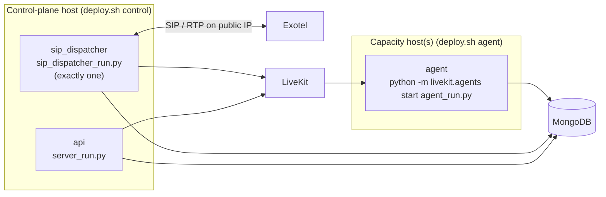

# Deployment

The parts of the system as a user sees them: [How it works](../../docs/concepts/index.md)
(public). This page covers how those parts are packaged and where they run.



## Server topology and startup

The SIP listener and the outbound dispatcher are two background services. Where they run depends
on the deployment:

- **Single container or local development:** both run inside the API process, started by the
  FastAPI lifespan in `src/api/server.py`. `ENABLE_SIP_LISTENER` and `ENABLE_DISPATCHER` both
  default to `true`.
- **Production Docker:** a dedicated `sip_dispatcher` container runs `sip_dispatcher_run.py` and
  owns both services. The `api` container sets `ENABLE_SIP_LISTENER=false` and
  `ENABLE_DISPATCHER=false`, so it can run several Gunicorn workers without SIP port conflicts or
  duplicate dispatchers.

The `agent` container starts the worker with `python -m livekit.agents start agent_run.py`.
Locally, `uv run agent_run.py dev` does the same through the SDK's deprecated Python CLI.

**Deploy the agent image before the API.** An older worker does not know a newer assistant mode.
For example, a worker without `duplex` treats a duplex assistant as `pipeline`, which needs a TTS
config the assistant does not have: the job ends and the caller hears nothing.

## Images and services

Production uses two role-specific images and three Compose services. The images are split so the
LiveKit worker does not carry FastAPI and the docs stack, and the control plane does not carry the
agent provider plugins.

| Service | Image (Dockerfile) | Command | Role |
|---|---|---|---|
| `api` | `api_livekit_control` (`docker/Dockerfile.control`) | `python server_run.py` | FastAPI HTTP API. In single-container mode it also runs the background services. |
| `sip_dispatcher` | `api_livekit_control` (`docker/Dockerfile.control`) | `python sip_dispatcher_run.py` | Singleton Exotel inbound SIP listener and outbound queue dispatcher |
| `agent` | `api_livekit_agent` (`docker/Dockerfile.agent`) | `python -m livekit.agents start agent_run.py` | LiveKit agent worker and provider integrations |

`api` and `sip_dispatcher` share the control image on purpose: they need different processes, not
different packages. Both run with `network_mode: host`; the `api` service sets
`ENABLE_SIP_LISTENER=false` and `ENABLE_DISPATCHER=false` so the listener and the dispatch loop run
only in `sip_dispatcher`.

### Agent image

`docker/requirements-agent.txt` holds what the worker path imports:

- `livekit-agents` with the Cartesia, Deepgram, ElevenLabs, Google, OpenAI and Sarvam extras,
  because the provider factories import them.
- `beanie` and `motor` for assistant, call, audio-asset and usage records.
- `httpx` for tools, inbound context and provider validation.
- `chevron` for prompt rendering.
- `numpy` and `onnxruntime` for local audio denoising and VAD.
- `boto3` for downloading prerecorded greetings from S3.
- `mistralai` (held below 3) for the Mistral TTS path.

The build also runs `python -m livekit.agents download-files` so model weights are in the image.

`scipy` is not used by the normal agent entrypoint; it is used by the SIP/RTP bridge on the
dispatcher path. `audioop-lts` only installs on Python 3.13 or newer, and the images use Python
3.12, so that line installs nothing today.

### Control image

`docker/requirements-control.txt` holds what the API, the dispatcher or the image build need:

- `fastapi[standard]` and `gunicorn` for the HTTP service.
- `beanie`, `motor`, `python-dotenv` and `httpx` for persistence and service integration.
- `livekit` and `livekit-api` for LiveKit API, RTC, SIP, token and bridge operations.
- `numpy`, `scipy` and `av` for audio-upload transcoding and SIP/RTP processing.
- `boto3` for audio-asset storage.
- `mcp` for the read-only `/mcp` documentation server.
- `mkdocs`, `mkdocs-material` and `mkdocs-redirects` to build the docs site during the image build.

`chevron` is still listed but is an agent prompt-rendering dependency; the API and dispatcher
entrypoints do not import it.

## Build time versus runtime

`docker/Dockerfile.control` builds one virtualenv in a builder stage, copies it into the final
stage, then runs `mkdocs build` there. So MkDocs stays installed in the final image even though
the API never imports it for a request. Removing it from the requirements without moving the build
into a separate stage breaks the image build.

Build-only dependencies cost image size and build time, not request RAM. Runtime memory goes to
the worker's provider plugins and local audio models, multiplied by worker processes and
concurrent calls. Installed packages do not each take RAM; a process pays for what it imports.
Image layers are shared on disk; each running container has its own process memory.

## Two-server deployment

| Host | Services | Main pressure |
|---|---|---|
| Control plane | `api` and one `sip_dispatcher` | API workers, MongoDB traffic, SIP/RTP bridge processes |
| Capacity node | one or more `agent` containers | Agent process memory, provider connections, local audio models |

An extra `agent` can also run on the control-plane host if it has CPU headroom.

Deploy by role with `./deploy.sh <mode>`. The script requires a `.env`, runs
`git pull origin master`, starts the Compose profile, and then runs `docker system prune -a -f`.

| Mode | Compose profiles | Dockerfiles |
|---|---|---|
| `control` | `control` (`api`, `sip_dispatcher`) | `docker/Dockerfile.control` |
| `agent` | `agent` (`agent`) | `docker/Dockerfile.agent` |
| `full` | `control` + `agent`, on one host | the root `Dockerfile` for all three services (`API_DOCKERFILE`, `DISPATCHER_DOCKERFILE`, `AGENT_DOCKERFILE`) |

The equivalent without the script:

```bash
docker compose --profile control up -d --build   # control plane
docker compose --profile agent up -d --build     # capacity node
```

Do not install both requirement files into every environment; use the profiles.

### The singleton SIP dispatcher

Only one `sip_dispatcher` may run across the whole deployment. It binds the Exotel SIP port and
owns the outbound dispatch loop; a second copy would fight over the port and double-dispatch
queued calls. The `api` service can then scale to several Gunicorn workers safely.

### Exotel addresses live on the control host

Exotel sends SIP and RTP to the host running `sip_dispatcher`. Set `EXOTEL_CUSTOMER_IP` (SIP) and
`EXOTEL_MEDIA_IP` (RTP) to that host's public or Elastic IP, never `0.0.0.0` or a private address,
and keep `EXOTEL_SIP_ALLOWED_IPS` as the INVITE source allowlist. Agent hosts need no public SIP
address.

## Sizing the caps

`MAX_CONCURRENT_JOBS`, `MAX_CONCURRENT_WEB_CALLS`, `MAX_CONCURRENT_MEETING_CALLS` and
`MAX_CONCURRENT_SESSIONS` ship with defaults that were not measured. Set them from a load test:
measure steady-state RSS and concurrency with `docker stats` before changing any
`MAX_CONCURRENT_*`, `GUNICORN_WORKERS`, or the worker's idle-process count (`num_idle_processes`
in `agent_run.py`). The worker refuses new jobs once it runs `MAX_CONCURRENT_SESSIONS`, so that
value must fit on one agent host. How the caps are enforced:
[Dispatcher and queue](../subsystems/dispatcher-and-queue.md).

## Safe dependency cleanup

Low-risk candidates, subject to the checks above:

| Change | Effect | Caveat |
|---|---|---|
| Remove `scipy` from the agent requirements | Smaller agent image, less unused import weight | Never run the SIP bridge from that image |
| Remove `chevron` from the control requirements | Smaller control image | Control code must not import agent prompt rendering |
| Keep `audioop-lts` conditional | No change on Python 3.12 | Needed only if the base image moves to 3.13 and a dependency needs it |
| Move MkDocs to a docs builder stage | Smaller final control image | Needs Dockerfile changes; does not materially reduce API RAM |

Do not remove `numpy`, `onnxruntime`, `av`, `boto3`, the MongoDB packages or the LiveKit packages
on image size alone. Each has a concrete runtime path.

## Where in the code

| What | File | Symbol |
|---|---|---|
| Deploy script | `deploy.sh` | `ROLE` (`control`, `agent`, `full`) |
| Services, profiles, host networking | `docker-compose.yml` | services `api`, `sip_dispatcher`, `agent` |
| Control image | `docker/Dockerfile.control`, `docker/requirements-control.txt` | |
| Agent image | `docker/Dockerfile.agent`, `docker/requirements-agent.txt` | |
| Single-host image | `Dockerfile` | |
| Worker options and load | `agent_run.py` | `server`, `_worker_load` |
| Dispatcher process | `sip_dispatcher_run.py` | `main` |
| Caps and Exotel settings | `src/core/config.py` | `Settings` |
