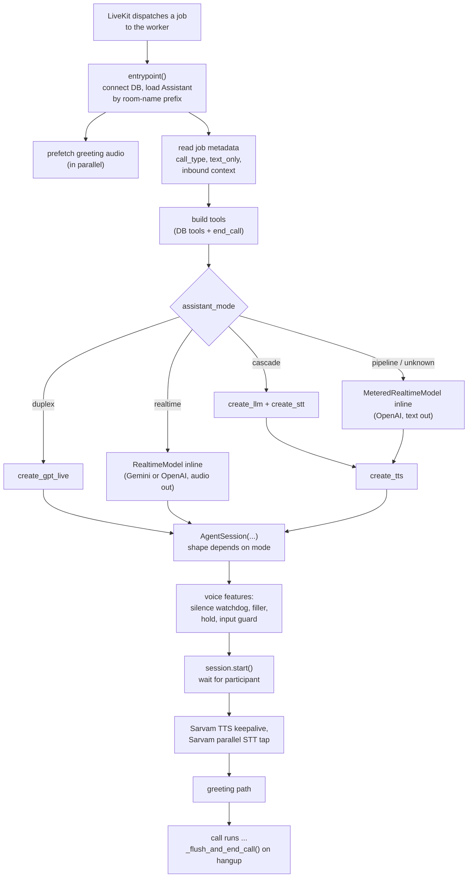
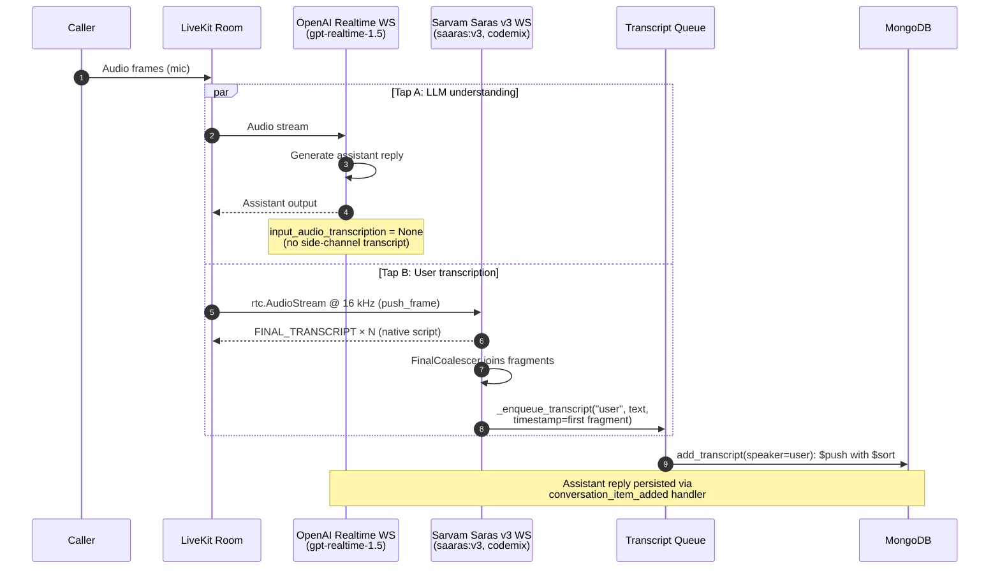

# Agent session

What each mode does for a caller is described in the public
[Assistant modes](../../docs/concepts/assistant-modes.md) page (and
[Cascade](../../docs/concepts/cascade.md), [Duplex](../../docs/concepts/duplex.md)). This page
explains how the worker builds a session for each mode, what runs beside it, and why.

The stage factories (STT, LLM, TTS), turn detection and usage metering have their own page:
[Speech and LLM stages](speech-and-llm-stages.md).

## The job, start to finish

## API startup services

The FastAPI `lifespan` in `src/api/server.py` initialises MongoDB, then starts two long-running
services if their flags allow it:

- the **Exotel inbound SIP listener** (`ensure_inbound_server`), gated by `ENABLE_SIP_LISTENER`;
- the **outbound call dispatcher** (`outbound_dispatcher_loop`), an event-driven loop that drains
  the outbound queue, gated by `ENABLE_DISPATCHER`.

Both flags default to `true` and are read with `os.getenv` directly in `lifespan`, so a
single-process dev setup needs no configuration. Accepting an outbound request and running it are
fully decoupled: the API only enqueues and returns, and the dispatcher handles pacing and retry.
Which process should own these services in production is in
[Deployment](../operations/deployment.md).

## Worker launch and load control

`agent_run.py` builds a module-level `AgentServer` named `server` from `WorkerOptions`, because the
SDK's CLI (`python -m livekit.agents start agent_run.py`) imports that file and looks for that
name first. The worker options live there rather than in `session.py` so that tests importing the
job handler do not build a worker. `uv run agent_run.py dev` goes through the SDK's deprecated
Python CLI and prints a warning saying so.

**Load.** `_worker_load` reports `len(worker.active_jobs) / MAX_CONCURRENT_SESSIONS` (capped at
1.0), and `load_threshold=1.0` makes the SDK refuse a job once the worker already runs that many.
The SDK default measured whole-machine CPU, which made intake depend on unrelated processes: when
the SIP dispatcher on the same host spiked CPU, the worker refused jobs and calls connected with no
agent behind them. The ceiling is the global `MAX_CONCURRENT_SESSIONS`, not the telephony cap,
because this worker runs every call type. A threshold below 1.0 would refuse jobs the dispatcher
still sends, which is again a call that connects to silence.

Other options set there: `job_memory_limit_mb=2048` (a hard ceiling; `job_memory_warn_mb=1024`
only logs), `num_idle_processes=4` (so a burst of calls does not queue behind cold process starts),
and `initialize_process_timeout=30.0` (cold imports can exceed the SDK's 10 s default).

## How `entrypoint()` builds each mode

`assistant_mode` is a plain string in MongoDB. `entrypoint()` sets three flags (`is_realtime`,
`is_duplex`, `is_cascade`); anything else, including an unrecognised value, falls into the
`pipeline` branch with a warning in the log. `speaks_own_audio = is_realtime or is_duplex` marks
the two modes with no TTS: nothing can `session.say()` a fixed string there, so spoken features
use `generate_reply` instead.

The provider defaults to `gemini` for `realtime` and `openai` otherwise
(`assistant_llm_config.provider`).

| Mode | LLM built by | TTS | `AgentSession(...)` |
|---|---|---|---|
| `cascade` | `create_llm(assistant, has_tools=...)`, plus `create_stt(...)` unless text-only | `create_tts` | `stt=, llm=, tts=, vad=inference.VAD(...)`, `turn_handling` with the local turn detector; see [turn detection](speech-and-llm-stages.md#turn-detection) |
| `duplex` | `create_gpt_live(assistant, has_tools=...)` | none | `llm=, vad=inference.VAD(model="silero", min_silence_duration=0.4)` |
| `realtime`, Gemini | `google_realtime.RealtimeModel(modalities=["AUDIO"])` inline | none | `llm=` only |
| `realtime`, OpenAI | `MeteredRealtimeModel(modalities=["audio"])` inline, semantic VAD | none | `llm=` only |
| `pipeline` | `MeteredRealtimeModel(modalities=["text"])` inline, semantic VAD | `create_tts` | `llm=, tts=`, `turn_detection="realtime_llm"`, dynamic endpointing 0.3–1.0 s |
| any, text-only web call | as above | none | `llm=` only |

A factory that returns `None` ends the job (`return`), with the reason already logged. `pipeline`
with provider `gemini` also ends the job: the API refuses it, so only a row edited outside the API
gets there (Google's Live API cannot do text-only output on native-audio models).

Both OpenAI realtime branches use `TurnDetection(type="semantic_vad", eagerness="high",
create_response=True, interrupt_response=False)`. The `pipeline` session deliberately sets no
`interruption={...}`: with `turn_detection="realtime_llm"` the SDK skips VAD-based interruption
entirely and interrupts as soon as the realtime model's VAD reports speech, so those knobs would be
dead config. Noise filtering happens upstream in `SpeechGate` instead.

### Context truncation

Both OpenAI realtime branches pass `truncation=RealtimeTruncationRetentionRatio(type="retention_ratio",
retention_ratio=0.75, token_limits=TokenLimits(post_instructions=8000))` when
`realtime_supports_truncation(model)` is true, and `None` otherwise. `session.truncation` is a GA
Realtime API field; the two beta models (`REALTIME_BETA_MODELS`: `gpt-4o-realtime-preview`,
`gpt-4o-mini-realtime-preview`) have no such field, and the API answers an unknown session field
with an error event instead of ignoring it. The beta models are no longer on the allowlist, but a
stored row can still hold one, so the check remains; such a session logs one line and runs without
the cap. Semantic VAD is sent to both generations.

### Duplex build (`create_gpt_live`)

`create_gpt_live` in `src/core/agents/llm/factory.py` builds `openai.realtime.GPTLiveModel` on
the deployment's own OpenAI key (the LiveKit Inference route would need Cloud credentials), with
`delegation="responses"`:

- `model` defaults to `DEFAULT_GPT_LIVE_MODEL` (`gpt-live-1`), `voice` to `DEFAULT_GPT_LIVE_VOICE`.
- `responses_options` carries the backend: `model` (`backend_model`, default
  `DEFAULT_DUPLEX_BACKEND_MODEL` = `gpt-5.6-luna`), `instructions` (`backend_instructions`, default
  `DEFAULT_DUPLEX_BACKEND_INSTRUCTIONS`), and the knobs `reasoning`, `text.verbosity`,
  `service_tier`, `tool_choice`, `parallel_tool_calls`, `max_output_tokens`.
- Each model-gated knob goes through `unsupported_knob_reason(backend_model, ...)`, the same rule
  `create_llm` uses, and is dropped with a warning when the backend cannot read it.
- The voice persona is not set here: it is the `Agent`'s own instructions (`assistant_prompt`).
- Tool schemas are built strict (`strict_schemas=is_cascade or is_duplex`) because the backend
  speaks the Responses API.
- A constructor exception is caught and logged and returns `None`, so it cannot escape
  `entrypoint()` as a traceback. One `Duplex model built | ...` line records model, voice, backend
  and knobs.

The session gets an explicit local Silero VAD because the SDK drops its default VAD for a duplex
model, and barge-in (cutting the audio the caller hears) needs one.

## Greeting path

After the participant joins, if `speaks_first` and a start instruction exist:

1. On an Exotel bridge, before waiting for `call_answered`, ring-tone audio must not open a turn:
   - realtime models with `allow_interruptions=false`: server VAD is switched off
     (`llm.update_options(turn_detection=None)`) and restored in `finally`;
   - cascade with `allow_interruptions=false`, and duplex always: `speech_gate.muted = True`,
     unmuted in `finally` (or the caller would stay muted all call).
2. `_wait_to_speak_or_hangup` waits for the readiness gate (60 s timeout); meeting calls wait for
   the connector instead.
3. A prerecorded greeting is played with `play_prerecorded_greeting` (never in duplex). Otherwise:
   duplex calls `session.generate_reply(...)` and checks `handle.exception()` because GPT-Live may
   decline; Gemini realtime sends the instruction as `LiveClientRealtimeInput`; OpenAI realtime,
   pipeline and cascade use `generate_reply(instructions=...)`.

With no greeting, `_mute_until_answered` mutes `SpeechGate` until answer (at most 60 s) in every
mode, because no greeting path is there to do it.

## Voice features

All live in `src/core/agents/voice_features.py` and are built in `entrypoint()`. All are off for
text-only chats.

| Controller | What it does | Mode notes |
|---|---|---|
| `SilenceWatchdogController` | After `silence_reprompt_interval` seconds of silence (default 10) re-prompts; after `silence_max_reprompts` (default 2) calls back `_end_call_on_silence`, which ends the call. Pauses while the agent speaks, restarts when it finishes, waits 5 s after each re-prompt. | `use_llm_for_speech=speaks_own_audio`: realtime and duplex re-prompt with `generate_reply`, the others `session.say` a fixed line |
| `FillerController` | While the user is speaking, waits 2–3 s, then every 4–6 s generates a 1–3 word backchannel with `gpt-4o-mini` (`generate_filler`, last 4 turns as context, avoiding the last 5 fillers) and speaks it with `session.say`. Started and stopped from `user_state_changed`. | Off when `speaks_own_audio` (no TTS). Always calls OpenAI, so it uses the assistant's LLM key only when the provider is OpenAI |
| `HoldController` | On a `call_hold` data packet from the SIP bridge, stops the watchdog and filler and interrupts the agent; on `call_resume`, restarts the watchdog. While on hold, any agent speech is interrupted as it starts. | All modes |
| `InputGuardController` | Mutes `SpeechGate` for `input_guard_window_sec` (default 3.0 s; `0` disables) at the start of each agent utterance, so a caller repeating themselves or saying "um" cannot barge in; unmutes early when the agent stops. Mutes rather than dropping frames because a realtime model (notably Gemini Live) can misbehave on a gap. | Off in duplex: GPT-Live listens while it speaks |

## Transcription paths

Exactly one thing writes user transcripts per call. Which one is decided in `entrypoint()`:

| Mode | Writer |
|---|---|
| `pipeline`, `assistant_stt_model="sarvam"` (default) | Sarvam parallel tap, `run_sarvam_parallel_stt` |
| `pipeline`, `native` / `openai` / any cascade-only provider / no key | the realtime model, via `conversation_item_added` |
| `realtime` | the realtime model, via `conversation_item_added` |
| `cascade` | the session's own STT stage, via `conversation_item_added` |
| text-only | the chat messages themselves |

`resolve_stt` returns the `(provider, config)` pair; see
[Speech and LLM stages](speech-and-llm-stages.md#two-stt-resolvers). In `pipeline`,
`_use_sarvam_stt = not is_text_only and provider == "sarvam"`. `_use_sarvam_stt` is bound before
the session exists because `_persist_usage` reads it and swallows exceptions; an unbound name would
silently zero the usage record.

### Sarvam parallel user transcription

**Why.** In OpenAI `pipeline` mode with native STT, `input_audio_transcription` uses an OpenAI
transcription model. On Indic code-switched speech it switches scripts mid-utterance, romanises,
and hallucinates on phone audio. The model cannot be replaced: `input_audio_transcription.model`
is a closed server-side list (`whisper-1`, `gpt-4o-transcribe`, `gpt-4o-mini-transcribe`,
`gpt-4o-transcribe-diarize`) that accepts no URL or third-party endpoint. So a Sarvam Saras v3 tap
(`saaras:v3`, `mode="codemix"`, `language="unknown"`) runs beside the model. The model still
consumes the audio for understanding; only the stored user transcript changes.

Mechanics:

- `run_sarvam_parallel_stt(...)` in `src/core/agents/stt/sarvam_parallel.py` is spawned once after
  the participant joins, scoped to the caller's identity, late-binding if the track is already
  published. The handle is kept in `_sarvam_task` so teardown can tell the two STT paths apart and
  a crash inside the tap is not swallowed.
- Stop signal: the same `_sarvam_stop` event that stops the Sarvam TTS keepalive.
- Frame pump: `rtc.AudioStream(track, sample_rate=16000, num_channels=1)` upsamples 8 kHz G.711
  phone audio in-process; frames go in with `stream.push_frame(frame)`.
- Usage: the pump sums each frame's duration into the `SttUsage` it was handed, which teardown
  turns into the call's `stt_usage` entry. The tap's STT never reaches the `AgentSession`, so this
  is the only place those seconds can be counted.
- With the tap on, the realtime model is built with `input_audio_transcription=None`, and
  `conversation_item_added` short-circuits user items, so no empty or stale OpenAI user item is
  written.
- `_enqueue_transcript(speaker, text, timestamp=None)` queues every DB write (Sarvam callback and
  assistant items alike), so the `add_transcript` call shape lives in one place.
- The coalescer's emit callback calls `silence_watchdog.on_user_message()`, like the native path.
- **Key.** `assistant_stt_config.api_key`, else `SARVAM_API_KEY`. Never
  `assistant_tts_config["api_key"]`: on a Cartesia, ElevenLabs or Mistral assistant that is a
  foreign key, and Sarvam answers `403 Invalid response status`. Because the tap disables the
  model's own transcription, an auth failure means no user transcripts at all; with neither key
  present `resolve_stt` degrades to `native` instead.
- The fields used to live in `assistant_interaction_config` (`user_stt_provider`, `stt_api_key`);
  `scripts/migrate_stt_config.py` moves them, and the old keys are rejected with `422`.

**Fragment coalescing.** `SpeechGate` zeroes non-speech audio after a 600 ms hangover
(`_HANGOVER_MS` in `src/core/agents/audio_denoise.py`), applied once per frame. A longer
intra-sentence pause reaches Sarvam as digital silence, its server VAD endpoints, and one sentence
comes back as several `FINAL_TRANSCRIPT` events. Written separately they make half-finished lines,
and with `language="unknown"` each scrap gets its own language decision, which is why the script
could flip mid-utterance. `FinalCoalescer` buffers fragments and emits one joined utterance after
`MERGE_WINDOW_S` (1.0 s) of quiet, or at once on `flush()`. `flush()` is called on
`agent_state_changed` to `speaking` (the agent talking means the user's turn is over) and at
teardown. A pause longer than the window still splits: raise `MERGE_WINDOW_S` or add flush
triggers if callers report split lines.

**One coalescer, both paths.** `_user_coalescer` is built once in `session.py` before the handlers
are registered. The tap feeds it via `run_sarvam_parallel_stt(coalescer=...)`; on the native path
`conversation_item_added` feeds it for `role == "user"`. Text-only chats skip it: there is no
endpointing to undo, and a debounce would merge two separately typed messages.

**Ordering.** Timestamps are stamped at capture, and a joined utterance carries its first
fragment's arrival time. User text costs a Sarvam round-trip plus the merge window, so it often
reaches Mongo after the reply it caused. `add_transcript` (`src/services/livekit/livekit_svc.py`)
appends with `{"$push": {"transcripts": {"$each": [entry], "$sort": {"timestamp": 1}}}}`, which
inserts in speaking order. Being one atomic update, it also cannot clobber transcripts when
`update_call_status`, `end_call` or the dispatcher safety net write the same document
concurrently. No read side sorts.

**Scope.** Only the stored transcript is corrected. To fix understanding as well, use `cascade`
or `realtime` + `gemini`.

### Native transcription

When the model transcribes itself (`native` in pipeline, always in realtime), text arrives through
`conversation_item_added`.

- **Prompt and noise reduction.** `src/core/agents/stt/native_prompt.py`:
  `build_native_stt_prompt` puts `preferred_languages` in as a hint plus the literal-transcription
  rules (native script, no romanisation, no translation, `[inaudible]` rather than a guess);
  `noise_reduction_for` picks `far_field` for phone calls (trained on lossy G.711) and `near_field`
  otherwise. `is_phone_call` (`src/core/call_types.py`) is a positive test: meeting audio is wideband, so it gets
  `near_field` and the non-phone prompt. Both OpenAI branches pass both.
- **Model.** `NATIVE_TRANSCRIBE_MODEL = "gpt-4o-mini-transcribe"` lives in
  `src/core/agents/stt/native_usage.py`, beside the usage tally, so the two cannot drift. The
  Indic failures came from an unprompted, untuned channel, not from model size, and mini takes the
  prompt and `far_field` just as `gpt-4o-transcribe` does. Upgrading is a one-word change, worth
  doing only against a measured accuracy comparison.
- **Language is never pinned.** `AudioTranscription.language` stays unset, matching the tap's
  `language="unknown"`.
- **Usage.** See [Speech and LLM stages](speech-and-llm-stages.md#per-stage-usage-metering)
  (`MeteredRealtimeModel`).
- **Gemini.** `genai_types.AudioTranscriptionConfig()` takes no arguments, so no prompt applies.

**`should_record(role, on_hold, gate_active)`** decides what reaches the transcript. Hold and the
readiness gate exist to keep the *agent* quiet, so they apply to assistant items only.
`CallReadinessGate.is_active` flips on one `call_answered` SIP data packet; gating user speech on
it meant one dropped packet discarded every user transcript for the call, silently. The Sarvam
callback never consulted either check, so this keeps both paths identical. Trade-off: pre-answer
ring audio and on-hold speech can be stored if the model transcribes any. Pinned by
`tests/test_should_record.py`. The `data_received` listener that flips the gate is registered
before `session.start()`, so the one `call_answered` packet cannot arrive while nobody listens.

## End of call

`call_end_triggered` and `_transcripts_closed` are separate flags. The first flips the moment a
hangup is seen and blocks duplicate teardown; the second closes the transcript queue only after
the active STT has handed over the caller's last utterance.

`_flush_and_end_call` on a voice call:

1. sets `_sarvam_stop`;
2. `session.interrupt(force=True)`: the SDK records an assistant turn only when playout ends or is
   interrupted, so a reply cut short by hangup would otherwise finish playing into an empty room
   after the transcript path closed, and be lost. The stored line is the part actually spoken;
3. asks the active STT to finalise, holds the transcript path open for `END_OF_CALL_GRACE_S`
   (4 s), then flushes `_user_coalescer` and closes the queue. The usage record and webhook wait
   the same 4 s.

| Path | How the tail is recovered |
|---|---|
| `sarvam` | The tap feeds Sarvam `DRAIN_SILENCE_S` (2 s) of digital silence before `end_input()`. Sarvam returns a segment only after its server VAD endpoints, and the plugin forwards that flush from inside its send loop, i.e. only when the next frame arrives. At hangup frames stop, so without synthetic silence the segment stays stuck server-side. `end_input()` cannot rescue it: the plugin sends `end_of_stream` and cancels its own reader in the same event-loop turn. Same technique as the SDK's `commit_user_turn` (`agents/voice/audio_recognition.py`). |
| `native`, OpenAI | `session.commit_user_turn(skip_reply=True)` sends `input_audio_buffer.commit`, so the model transcribes pending audio and fires one more `conversation_item_added`; `skip_reply` stops it answering. The future is **not** awaited: with no separate STT it resolves at once, so the 4 s sleep is the grace. |
| `native`, Gemini | Not recoverable. The plugin logs `commit_audio` as unsupported, and a user transcript is final only on `server_content.turn_complete`, which a mid-turn hangup never reaches. |
| `cascade` | `commit_user_turn(skip_reply=True)` again, but the session owns a real STT, so the future resolves when it flushes. It **is** awaited (shielded), capped at 4 s. |
| text-only | Nothing to drain. |

**`end_call` tool.** Realtime and duplex models emit the goodbye as a new speech handle after the
tool returns, so the done-callback waits for `speech_created` (5 s timeout) and then playout. A
cascade LLM continues in the same speech handle across tool steps, so the goodbye has already
played when the callback runs; waiting for `speech_created` there only burned 5 s of dead air, so
cascade skips it.

## Where in the code

| What | File | Symbol |
|---|---|---|
| API startup services | `src/api/server.py` | `lifespan` |
| Inbound SIP listener start | `src/services/exotel/custom_sip_reach/inbound_listener.py` | `ensure_inbound_server` |
| Dispatcher loop | `src/services/outbound_dispatcher/dispatcher.py` | `outbound_dispatcher_loop` |
| Worker options, load | `agent_run.py` | `server`, `_worker_load` |
| Job handler | `src/core/agents/session.py` | `entrypoint` |
| Duplex model | `src/core/agents/llm/factory.py` | `create_gpt_live` |
| GPT-Live defaults, truncation rule | `src/core/model_support/capabilities.py` | `DEFAULT_GPT_LIVE_MODEL`, `DEFAULT_DUPLEX_BACKEND_MODEL`, `realtime_supports_truncation`, `REALTIME_BETA_MODELS` |
| Strict tool schemas | `src/core/model_support/tool_schema.py` | `strict_schemas` parameter |
| DB tools | `src/core/agents/tool_builder.py` | `build_tools_from_db` |
| Greeting | `src/core/agents/session.py` | `play_prerecorded_greeting`, `_wait_to_speak_or_hangup`, `_mute_until_answered` |
| Readiness gate | `src/core/agents/session_lifecycle.py` | `CallReadinessGate`, `should_record_on_join` |
| Voice features | `src/core/agents/voice_features.py` | `SilenceWatchdogController`, `FillerController`, `generate_filler`, `HoldController`, `InputGuardController` |
| Noise gate | `src/core/agents/audio_denoise.py` | `SpeechGate`, `_HANGOVER_MS` |
| Sarvam tap | `src/core/agents/stt/sarvam_parallel.py` | `run_sarvam_parallel_stt`, `FinalCoalescer`, `SttUsage`, `MERGE_WINDOW_S`, `DRAIN_SILENCE_S` |
| Native transcription | `src/core/agents/stt/native_prompt.py`, `native_usage.py` | `build_native_stt_prompt`, `noise_reduction_for`, `NATIVE_TRANSCRIBE_MODEL` |
| Transcript write | `src/core/agents/session.py`, `src/services/livekit/livekit_svc.py` | `_enqueue_transcript`, `should_record`, `add_transcript` |
| Teardown | `src/core/agents/session.py` | `_flush_and_end_call`, `END_OF_CALL_GRACE_S` |
