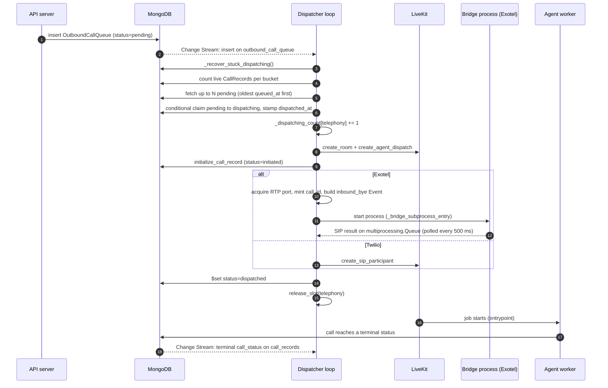

# Dispatcher and queue

Behaviour as the user sees it (queue states, retries, 503 / 486 at capacity):
[Call lifecycle](../../docs/concepts/call-lifecycle.md). This page explains how the outbound
queue, the dispatcher loop and the capacity counters work, and why.

## Where it runs

`outbound_dispatcher_loop()` is started either by the API server (when `ENABLE_DISPATCHER=true`,
the dev default) or by the dedicated `sip_dispatcher_run.py` process in production. Exactly one
dispatcher should run across all hosts: the claim step below makes a second one safe, but not
useful. Both start it with `log_dispatcher_exit` as a done-callback, because the task is only
awaited at shutdown and a crash would otherwise be invisible while nothing gets dialled.

## The loop

### What wakes it

The loop waits on one `asyncio.Event` (`_new_call_event`) with a 30 second timeout. Three things
wake it:

| Source | Fires on |
|---|---|
| `_watch_for_new_calls()` | A Change Stream on `outbound_call_queue`, `insert` operations only. Works across containers: the API that inserts and the dispatcher that dials do not need to share a process. |
| `_watch_for_call_completions()` | A Change Stream on `call_records`, updates whose `call_status` becomes terminal (`completed`, `failed`, `busy`, `no_answer`, `rejected`, `cancelled`, `unreachable`, `timeout`). A finished call frees a slot, so the next pending call is chained immediately. |
| The 30 s timeout | Safety net for events missed while a stream was restarting. With nothing queued, a tick does almost nothing. |

Both watchers restart after a 5 second sleep on any error. Change Streams need a replica set;
MongoDB Atlas always runs one.

### One tick

Each wake runs `_recover_stuck_dispatching()` then `_process_pending()`, inside a `try` that logs
and carries on, so one bad tick never ends dispatching.

`_process_pending()`:

1. Counts live calls per bucket (`_get_active_session_counts()`, see below).
2. Computes `slots = min(MAX_CONCURRENT_JOBS - telephony, MAX_CONCURRENT_SESSIONS - total)`.
   Outbound calls are always telephony, so both the telephony cap and the global ceiling bound
   them.
3. Reads up to `slots` rows with `status == "pending"`, oldest `queued_at` first.
4. Claims each one with a **conditional update** (`status: pending` to `dispatching`, filtered
   on `status == "pending"`), not a read followed by `save()`. If `modified_count` is 0 someone
   else claimed it, and it is skipped. This is what stops two dispatchers, or one dispatcher
   racing its own stuck-item sweep, from dialling the same number twice.
5. The claim stamps `dispatched_at`, increments `_dispatching_count[TELEPHONY]`, and starts
   `_dispatch_queued_call(item)` as a task.

### Startup

Before entering the loop, `outbound_dispatcher_loop()` runs `_fail_stale_calls_on_startup()`
(which is the orphan reaper, below) and one `_process_pending()`, so requests left `pending`
across a restart are dialled at once. A failure in that startup pass is logged and the loop
starts anyway. It then starts the two watchers and `_orphan_reaper_loop()`.

## Dispatching one call

`_dispatch_queued_call(item)`:

1. Loads the trunk; an inactive or missing trunk raises, which counts as a failed attempt.
2. **Passthrough** (`trunk.passthrough_mode` and the row has `passthrough_room_name`): reuse the
   room the API already created and dispatch no agent. Otherwise create a room and an agent
   dispatch, with `to_number` and `call_service` added to the job metadata.
3. **Twilio:** write the `CallRecord` (`initiated`), call `create_sip_participant`. Passthrough
   starts the room recording right away. A normal call gets a `_watch_agent_join` task.
4. **Exotel:** write the `CallRecord`, then pre-allocate everything the parent must be able to
   clean up however the child dies: an RTP port from `PortPool`, a fresh `call_id` UUID, and an
   `inbound_bye` Event registered with the inbound SIP listener (a BYE for this call can arrive on
   a different TCP connection). Start the bridge process from `get_bridge_context()`, then start
   `_monitor_exotel_result` and, for non-passthrough calls, `_watch_agent_join`.
5. Mark the row `dispatched` with a targeted `$set` (not `save()`, which would overwrite fields
   another writer changed meanwhile).
6. On any exception: `retry_count += 1`, `last_error = str(e)`, and the row goes back to
   `pending`, or to `failed` once `retry_count >= MAX_RETRIES` (3). So "3 retries" means three
   attempts in total.
7. `finally`: `release_slot(TELEPHONY)`. By now the `CallRecord` exists and is counted from the
   database.

The process layout of the bridge itself is in [Telephony (Exotel)](telephony-exotel.md).

### Monitoring an Exotel bridge

`_monitor_exotel_result` owns the bridge process for its whole life.

| Phase | What happens |
|---|---|
| SIP setup (max 60 s) | Polls the result queue every 500 ms. No result: SIGTERM the bridge, status `timeout`, send the webhook. A failed result: write the SIP status and code it carried (`busy`, `no_answer`, ...), send the webhook. |
| Answered | Write `answered` and `answered_at` (duration is measured from pickup). Passthrough starts the room recording here, because no agent session exists to do it. Then poll `is_alive()` every 2 s until the bridge exits. |
| Bridge exited | Passthrough: `end_call()`, the trunk's webhook, `delete_room()`. Normal call: `_finalize_if_agent_failed()`. |
| Cancelled (shutdown) | Terminate the bridge, stop a passthrough recording, mark the call `failed` unless it is already terminal, send the webhook, re-raise. |
| `finally` | Reap the process in a thread (`_reap_bridge`: join 3 s, then SIGKILL), then release the port and unregister the `call_id`. Reaping first matters: a zombie still holds its UDP socket. |

`_finalize_if_agent_failed()` exists because the agent session owns finalization (status,
duration, webhook). It polls the `CallRecord` once a second for `FINALIZE_WAIT_SECONDS` (15),
which is longer than the session's worst-case teardown (~8 s). Only if the record is still not
terminal does it call `end_call()` itself. Writing a status straight away would trip the
session's terminal-status guard and skip the webhook.

### The silent-agent watchdog

`call_status = "answered"` is written from the telephony side and says nothing about whether the
agent made it into the room. `_watch_agent_join()` closes that gap: it polls the `CallRecord` once
a second and ends the call if it has been answered for `AGENT_JOIN_GRACE_SECONDS` (15) with no
`agent_ready_at`. The agent sets `agent_ready_at` through `mark_agent_ready()` right after
`session.start()`. If the call is never answered within `AGENT_ANSWER_WAIT_SECONDS` (60) the
watchdog gives up quietly; that is a ring timeout, not its problem. It runs for Twilio outbound,
Exotel outbound and Exotel inbound; inbound passes `already_answered=True` and is armed only after
the 200 OK.

## Capacity control

### Buckets

Calls cost different amounts, so each has its own cap, plus a global ceiling:

| Bucket | Setting | Default | Call types |
|---|---|---|---|
| `telephony` | `MAX_CONCURRENT_JOBS` | `12` | `inbound`, `outbound` (including passthrough), and anything unrecognised |
| `web` | `MAX_CONCURRENT_WEB_CALLS` | `40` | `web` |
| `meeting` | `MAX_CONCURRENT_MEETING_CALLS` | `4` | `meeting` |
| (all) | `MAX_CONCURRENT_SESSIONS` | `48` | hard ceiling across every bucket |

`bucket_for_call_type()` maps `CallRecord.call_type` to a bucket. Passthrough is a boolean on an
`outbound` row, not a call type, so it lands in telephony with no special case, which is right: it
holds a bridge process and an RTP port. Rows with no `call_type` (written before the field
existed) also count as telephony, the scarcest bucket and so the safe direction to be wrong in.

A phone call needs an agent job, a bridge process and an RTP port; a web call needs only the
agent job; a meeting call holds a headful Chrome in a connector container. None of the web,
meeting or global defaults is measured. The only figure available is a ~238 MiB import floor per
agent job process. Set them from a load test (steady-state RSS per session from `docker stats`).

### Counting

`_get_active_session_counts()` is one aggregation over `call_records`, matching
`call_status in ["initiated", "answered"]` and grouping by `call_type`, served by the
`(call_status, call_type)` index. It runs on every inbound INVITE and every web-call token
request, so it must not be a collection scan that grows with call history. To each bucket it adds
`_dispatching_count[bucket]`: in-memory reservations for calls whose slot is taken but whose
`CallRecord` is not written yet (roughly a 100 ms window). Once the record exists it is counted
from the database and the reservation is released.

### Reserving

`try_reserve_slot(bucket)` holds `_slot_lock` across count-and-increment. Without the lock the
`await` inside the count let a burst of concurrent callers all see the same pre-burst count and
all pass, so the cap was weakest exactly under the burst it exists for. It refuses if the global
ceiling is reached or the bucket's cap is reached.

| Caller | Reserves | Released |
|---|---|---|
| Outbound dispatcher | `_process_pending` increments `_dispatching_count` directly after the claim | `finally` of `_dispatch_queued_call` |
| Web call token | `try_reserve_slot(WEB)`; `503` on refusal | Right after the `CallRecord` is written, or on any error before it |
| Meeting call | `try_reserve_slot(MEETING)`; `503` on refusal | As for web |
| Inbound INVITE | `try_reserve_slot(TELEPHONY)` after the assistant is resolved; SIP `486 Busy Here` on refusal | After the inbound `CallRecord` is written, or on failure before it |

`MAX_CONCURRENT_INVITE_SETUPS` (default `24`) is a separate `asyncio.Semaphore` in the inbound
listener. It bounds INVITEs **in setup**, not live inbound calls: the slot is freed once the call
is answered. The ring-until-agent-ready wait happens inside it, so it must exceed the number of
calls that can ring at once.

### The worker's own limit

The agent worker is a second, independent guard. `agent_run.py` passes `load_fnc=_worker_load`
and `load_threshold=1.0`. `_worker_load` returns `len(worker.active_jobs) / MAX_CONCURRENT_SESSIONS`,
so the worker refuses a job only once it already runs `MAX_CONCURRENT_SESSIONS` jobs. It is
measured against the global ceiling, not the telephony cap, because the worker runs the agent for
every call type. A threshold below 1.0 would refuse jobs the dispatcher is still willing to send,
and a dispatched call with no agent is a call that connects to silence.

The SDK default load function averages CPU across the whole machine. That coupled agent intake to
unrelated load: when the SIP dispatcher spiked CPU starting bridge processes, the worker stopped
taking jobs and calls connected with nobody behind them. Counting its own jobs keeps the decision
local.

## Recovery

| Failure | Mechanism |
|---|---|
| Dispatcher restart | `_fail_stale_calls_on_startup()` runs `_reap_orphaned_calls()`: for each `initiated`/`answered` record, ask LiveKit whether its room still exists, and fail only those whose room is gone. Agent containers outlive a dispatcher restart, so failing every active record would cut every live call on the platform. `_dispatching_count` starts at zero with the new process. |
| Orphaned records during normal running | `_orphan_reaper_loop()` runs the same reaper every `ORPHAN_REAPER_INTERVAL_SECONDS` (30 minutes). It catches agent crashes, Twilio calls (no monitor), web tokens never used, and bridges that died without `end_call()`. Records whose room still exists are skipped, so long calls are safe. |
| Crash mid-dispatch | `_recover_stuck_dispatching()`, on every tick, resets rows in `dispatching` with `dispatched_at` older than `STUCK_DISPATCHING_MINUTES` (5) to `pending`, or `failed` at `MAX_RETRIES`, with `last_error = "Worker crashed mid-dispatch"`. The cutoff uses `dispatched_at`, stamped at claim time; using `queued_at` would flag any call that waited long in the queue as stuck the instant it was claimed, and dial it twice. |
| Inbound failures | Inbound has no queue row. Its reservation is released on the failure path in `handle_inbound_call`, and orphaned records are caught by the reaper. |

## Where in the code

| What | File | Symbol |
|---|---|---|
| Loop, startup pass, wake event | `src/services/outbound_dispatcher/dispatcher.py` | `outbound_dispatcher_loop`, `_new_call_event`, `log_dispatcher_exit` |
| Change Stream watchers | `src/services/outbound_dispatcher/dispatcher.py` | `_watch_for_new_calls`, `_watch_for_call_completions` |
| Claiming and dispatch | `src/services/outbound_dispatcher/dispatcher.py` | `_process_pending`, `_dispatch_queued_call` |
| Exotel bridge monitor | `src/services/outbound_dispatcher/dispatcher.py` | `_monitor_exotel_result`, `_finalize_if_agent_failed`, `_reap_bridge`, `_terminate_bridge` |
| Silent-agent watchdog | `src/services/outbound_dispatcher/dispatcher.py` | `_watch_agent_join` |
| Buckets and reservations | `src/services/outbound_dispatcher/dispatcher.py` | `bucket_for_call_type`, `BUCKET_CAPS`, `_get_active_session_counts`, `try_reserve_slot`, `release_slot` |
| Recovery | `src/services/outbound_dispatcher/dispatcher.py` | `_fail_stale_calls_on_startup`, `_reap_orphaned_calls`, `_orphan_reaper_loop`, `_recover_stuck_dispatching` |
| Bridge process context | `src/services/outbound_dispatcher/dispatcher.py` | `get_bridge_context` |
| Cap settings | `src/core/config.py` | `Settings` (`MAX_CONCURRENT_*`) |
| Call-type vocabulary | `src/core/call_types.py` | `CALL_TYPE_WEB`, `CALL_TYPE_MEETING`, `NON_TELEPHONY_CALL_TYPES` |
| Queue and call documents | `src/core/db/db_schemas.py` | `OutboundCallQueue`, `CallRecord` |
| Outbound and passthrough endpoints | `src/api/routes/call.py` | `trigger_passthrough_call`, `/outbound`, `/queue/{queue_id}` routes |
| Web and meeting reservations | `src/api/routes/web_call.py`, `src/api/routes/meeting_call.py` | `get_token`, `/join` route |
| INVITE setup semaphore | `src/services/exotel/custom_sip_reach/inbound_listener.py` | `_get_invite_semaphore`, `_run_invite` |
| Worker load | `agent_run.py` | `_worker_load` |
| Agent readiness timestamp | `src/services/livekit/livekit_svc.py` | `LiveKitService.mark_agent_ready` |
| Process entry points | `sip_dispatcher_run.py`, `src/api/server.py` | startup that creates the dispatcher task |
