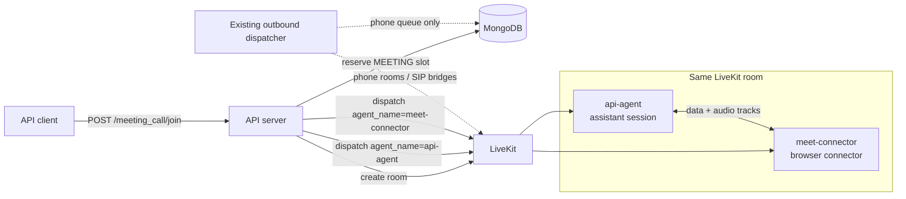
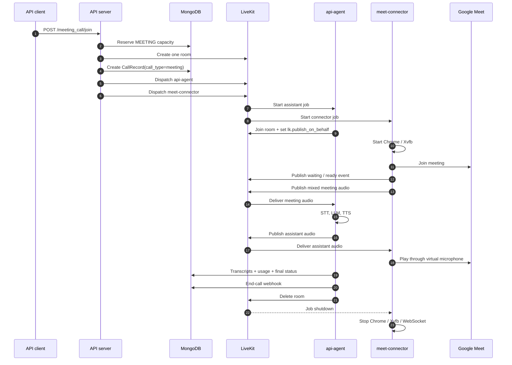
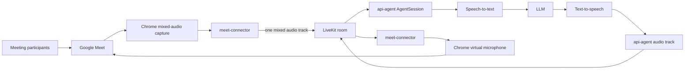

# Meeting calls

What a user sees: [Meeting calls](../../docs/concepts/meeting-calls.md) (public). The contract an
external connector implements: [Build a meeting connector](../../docs/guides/meeting-connector.md).

A meeting call is one LiveKit room with **two** LiveKit agent jobs in it: `api-agent` (this repo's
worker, running the assistant) and `meet-connector` (a separate service that runs Chrome and
bridges the room to Google Meet). It does not add a second application-level dispatcher.

## Dispatch topology



`agent_name` is a LiveKit worker routing key. The second dispatch is not a second queue processor:
the meeting route calls LiveKit's dispatch API directly, the same way the web-call route does for
`api-agent`, and `src/services/outbound_dispatcher/dispatcher.py` is not involved.

The route (`join_meeting`) does its work in this order, cheapest rejection first:

1. Load the assistant (`404` if missing) and validate the URL against the platform's pattern
   (`400`) before anything is reserved or created.
2. `try_reserve_slot(MEETING)` (`503` on refusal).
3. Create the room, write the `CallRecord` (`call_type=meeting`, `call_service=<platform>`,
   `call_status=initiated`), then `release_slot(MEETING)`: from here the DB row does the counting.
4. Dispatch `api-agent` with the meeting fields in job metadata, then set
   `meeting_connector_status=pending` and `meeting_url` on the record.
5. Dispatch the connector under `MEETING_CONNECTOR_AGENT_NAME` with `call_type`, `platform`,
   `meeting_url` and `bot_display_name` (falls back to the assistant name, then `Assistant`).

### Participants by call type

Every call type puts exactly two parties in one room. What differs is what the second party is,
and whether a second agent job had to be dispatched to create it.

| Call type | Agent dispatches | Participants in the room | Who publishes audio |
|---|---|---|---|
| Web | 1: `api-agent` | Agent job + the browser user | Agent; the user unless `text_only` |
| **Meeting** | **2: `api-agent` + `meet-connector`** | Agent job + connector job. **No human is ever in this room**; the humans are in Google Meet | Agent; the connector's single `meet-audio-mixed` track |
| Phone / Twilio | 1: `api-agent` | Agent job + a LiveKit-native SIP participant | SIP participant carries the caller; agent carries the replies |
| Phone / Exotel | 1: `api-agent` | Agent job + a bridge subprocess the dispatcher owns, joining as `sip-<number>` | Bridge publishes the caller's RTP as a microphone track |
| Passthrough | **0** | Browser user + SIP participant or Exotel bridge | Both human sides |

In every row the two parties subscribe to each other.

Why the connector is a job and the Exotel bridge is not: both are media bridges that terminate a
far-end transport and expose it as an audio track, but the Exotel bridge is a subprocess our own
process starts, while the connector needs a whole browser and a machine that can run one. That is
a different capacity and deployment problem, so LiveKit schedules it onto its own workers.

The assistant never talks to Google Meet and the connector never talks to a model; each only sees
the room. That keeps the connector replaceable: Zoom or Teams is the same contract with different
browser automation behind it. On our side, adding a platform means one entry in
`MEETING_URL_PATTERNS` and one member in `MEETING_PLATFORMS`.

### Normal call compared with a meeting call



A normal web or phone call is the same sequence without the `meet-connector` lane: one dispatch,
one job, and the agent joins, converses, writes transcripts and usage, sends the webhook and
deletes the room.

## Audio flow

The connector is a media bridge, not a second assistant. It runs no STT, LLM, TTS, usage
accounting or conversation logic.



### Meeting to assistant

The connector's page intercepts every inbound WebRTC audio track Google Meet creates and sums them
into one Web Audio mix. The mix is downmixed to mono, framed, sent to the connector's Python
process, and published as one LiveKit track named `meet-audio-mixed`. Capture is incremental: a
participant who joins after admission is added when their track appears.

One mixed track matches the `AgentSession` model of one linked participant, so the assistant hears
everyone. The cost is that transcripts cannot attribute a sentence to a speaker.

The assistant subscribes to that track like any other input. For meeting calls only, the
participant kinds the session accepts are widened to include `PARTICIPANT_KIND_AGENT`
(`meeting_participant_kinds` in `entrypoint`), because the connector is itself an agent job; on
every other call type a participant of that kind is ignored.

### Assistant to meeting

Before `session.start()`, the assistant connects and sets an attribute on its own participant:

```text
lk.publish_on_behalf = <LiveKit room name>
```

The connector selects the assistant's output track by that attribute. The value is the room name,
not an identity, because LiveKit mints the agent's identity inside the job token: nobody knows it
before the agent joins, while both sides already hold the room name. It must be set before
`session.start()` because the SDK's RoomIO publishes the microphone track from its own init task,
and the connector's browser adapter decides once, when the track is subscribed, with no retry on
attribute change. `ctx.connect()` is idempotent, so hoisting it changes nothing for other call
types.

The connector sums every track it receives from the assistant and plays the sum into Chrome's
virtual microphone, which Google Meet sees as an ordinary input device.

Two rules every connector must obey (both restated in the public connector guide):

- **Subscribe as a visible participant.** LiveKit does not tell a publisher when a *hidden*
  participant subscribes. The agents SDK waits for that notification before forwarding any audio
  frame, so a hidden connector leaves the assistant inaudible in the meeting and absent from the
  recording and transcript, while the model runs and bills for the whole call. The cost of
  joining visibly is one extra participant that publishes nothing.
- **Mix the assistant's tracks, never pick one.** The assistant publishes speech and background
  audio as separate tracks on one participant. A single `MediaStream` keeps one audio track per
  kind, so whichever arrives last wins. Background audio starts after the greeting, so the symptom
  is a meeting that hears ambience and never the assistant.

## Lifecycle signals

The connector publishes JSON on the `meeting_connector_events` data topic:

```json
{"event": "waiting", "detail": "waiting for admission"}
{"event": "ready"}
{"event": "failed", "detail": "browser could not join meeting"}
{"event": "ended", "detail": "meeting ended"}
```

It also sets `lk.meeting_connector_status=ready` on its own participant at the moment it publishes
`ready`. LiveKit does not replay data packets to late subscribers, so readiness reaches the
assistant over three independent, idempotent paths:

1. the `ready` packet on the data topic;
2. the attribute, through the room's attributes-changed event, which survives a dropped packet;
3. a direct read of the attribute off the participant returned by `wait_for_participant`, which
   covers `ready` published before the assistant finished connecting.

The listener is registered before `session.start()`. Unknown events are logged and ignored. Each
event is handled under one lock (`meeting_connector_event_lock`), persisted by
`record_meeting_connector_event`, and then:

- `ready` sets the readiness event and moves `call_status` from `initiated` to `answered` with
  `answered_at`;
- `failed` marks the call `failed` (reason = event detail, or `Meeting connector failed`) unless
  it is already terminal, then ends the call once;
- `ended` ends the call once through the normal finalization path.

Connector state is stored separately from the assistant's own `agent_ready_at` (set when the
session started):

| Field | Meaning |
|---|---|
| `meeting_connector_status` | `pending`, `waiting`, `ready`, `failed`, or `ended` |
| `meeting_connector_ready_at` | First time the connector became ready |
| `meeting_connector_ended_at` | When the connector entered a terminal state |
| `meeting_connector_status_reason` | Optional failure or termination detail |

### The two deadlines

The assistant waits for readiness before its greeting, and also when it does not speak first.
Two settings bound the wait because they answer different questions:

| Setting | Default | Question | Failure reason written |
|---|---|---|---|
| `MEETING_CONNECTOR_JOIN_TIMEOUT_SECONDS` | `120` | Did the connector worker join the LiveKit room? No human involved: a miss means no capacity, no registered worker, or a wrong dispatch name. | `Meeting connector did not join the room` |
| `MEETING_CONNECTOR_READY_TIMEOUT_SECONDS` | `360` | Did the connector get into the meeting, including a human admitting it? | `Meeting connector readiness timed out` |

The ready default is coupled to the connector service: it must stay above that service's own
300-second waiting-room budget, so the connector's `failed` event (with a real reason) arrives
first. `tests/test_meeting_calls.py` pins that relationship. In both timeout cases the assistant
marks the call failed, finalizes it, sends the end-call webhook and deletes the room.

A diagnostic task (`_watch_agent_track_subscription`) waits for readiness, then gives the
connector's browser 15 seconds to subscribe to the assistant's audio track. It never fails the
call. It logs `Agent audio track subscribed — assistant audio can reach the meeting`, or a warning
that the browser never subscribed, so a silent meeting is diagnosable from the log.

## Ownership: recording, usage, billing and teardown

`api-agent` is the only owner of call accounting.

| Responsibility | Owner | Notes |
|---|---|---|
| Assistant conversation | `api-agent` | Loads the assistant and runs STT, LLM and TTS |
| Meeting browser | `meet-connector` | Chrome, Xvfb, WebSocket relay, Google Meet |
| LiveKit room | API creates; `api-agent` finalizes | The API deletes the room itself only when setup failed, before any worker owns it |
| `CallRecord` | `api-agent` | One record per meeting call |
| Transcripts | `api-agent` | Assistant and mixed-meeting utterances |
| `UsageRecord` | `api-agent` | LLM, TTS and STT usage |
| Recording | `api-agent` | Audio-only room-composite egress, so it captures both jobs' tracks. `should_record_on_join` returns false for meetings; recording starts in `_wait_for_meeting_connector` once the connector is `ready`, waiting up to `MEETING_RECORDER_START_TIMEOUT_SEC` so the greeting is not clipped. Starting at session setup put 30-40 s of waiting-room silence at the head of every file. Never admitted, never recorded. |
| End-call webhook | `api-agent` | Sent once through the normal finalization path |
| Browser cleanup | `meet-connector` | Job shutdown stops Chrome, Xvfb and the WebSocket |

The connector must not create a `CallRecord`, `UsageRecord`, recording or webhook: two jobs would
race over one call's lifecycle.

Billing follows the normal rule in `calculate_billable_duration_minutes`: duration runs from
`answered_at` (connector `ready`) to `ended_at`, and a `failed` call bills `0` minutes.

## Capacity and dispatchers

Two independent caps:

1. **`MAX_CONCURRENT_MEETING_CALLS`** (default `4`, not measured): the business cap on accepted
   meeting calls. It is the `MEETING` bucket in `BUCKET_CAPS`, counted from meeting `CallRecord`
   rows plus short-lived in-memory reservations, and it also sits under the global
   `MAX_CONCURRENT_SESSIONS` ceiling. Meetings get their own bucket because a headful Chrome is
   expensive in a resource neither the web nor the telephony cap measures.
2. **The connector worker's LiveKit `load_fnc`**: the machine cap on how many browser jobs that
   worker deployment can run. It lives in the connector service, not here.

The outbound dispatcher still owns queued phone calls, SIP setup, reservations, retries and stuck
queue recovery. It never starts or stops connector jobs.

## Failure paths

| Failure | What happens |
|---|---|
| Assistant dispatch fails | `_abandon_room`: mark the setup record failed when possible, delete the room, release any reservation still held, and send the end-call webhook so the caller learns the call will not happen. It needs `assistant_id`, because `end_call` resolves the webhook URL from the assistant. |
| Connector dispatch fails | The assistant dispatch may already exist. Same `_abandon_room` path, so the assistant is not left in an orphaned room and the meeting slot is not held. |
| Connector never joins the room | Join deadline: `Meeting connector did not join the room`. A worker problem, not a browser one. |
| Connector joins, never ready | Ready deadline: `Meeting connector readiness timed out`. Usually a bot left in the waiting room; a well-behaved connector reports `failed` first. |
| Connector fails after joining | `failed` event: persist, mark failed, webhook once, tear down the room. |
| Meeting ends normally | `ended` event or connector job shutdown; `api-agent` finalizes. |
| Assistant ends the call | `end_call` tool, silence watchdog out of re-prompts, or `max_call_duration_minutes`. Same finalization path; deleting the room is the connector's cue to leave. `CallRecord.call_end_reason` is `end_call_tool`, `silence_timeout` or `max_duration_exceeded`. |

## Deployment boundary

This repository creates both dispatches and owns everything about the call except the browser.
It does not ship the connector. A meeting call completes end to end only when a worker is
registered with LiveKit under `MEETING_CONNECTOR_AGENT_NAME` (default `meet-connector`) and
implements the contract in [Build a meeting connector](../../docs/guides/meeting-connector.md).
The API needs no Docker access to the connector host.

## Where in the code

| What | File | Symbol |
|---|---|---|
| Join endpoint | `src/api/routes/meeting_call.py` | `join_meeting` |
| Setup-failure cleanup | `src/api/routes/meeting_call.py` | `_abandon_room` |
| Request schema | `src/api/models/api_schemas/meeting.py` | `TriggerMeetingCall` |
| URL validation per platform | `src/services/meeting_connector/platforms.py` | `MEETING_URL_PATTERNS`, `validate_meeting_url` |
| Topic, attribute, event names, platforms | `src/core/call_types.py` | `MEETING_CONNECTOR_EVENTS_TOPIC`, `MEETING_CONNECTOR_STATUS_ATTRIBUTE`, `MEETING_CONNECTOR_EVENTS`, `MEETING_PLATFORMS` |
| Settings | `src/core/config.py` | `MEETING_CONNECTOR_AGENT_NAME`, `MEETING_CONNECTOR_JOIN_TIMEOUT_SECONDS`, `MEETING_CONNECTOR_READY_TIMEOUT_SECONDS`, `MAX_CONCURRENT_MEETING_CALLS` |
| Capacity bucket | `src/services/outbound_dispatcher/dispatcher.py` | `BUCKET_CAPS`, `try_reserve_slot`, `release_slot` |
| Event handling, deadlines, `lk.publish_on_behalf` | `src/core/agents/session.py` | `entrypoint`, `_handle_meeting_connector_event`, `_wait_for_meeting_connector`, `_watch_agent_track_subscription` |
| Recording gate | `src/core/agents/session_lifecycle.py` | `should_record_on_join`, `RecordingManager.ensure_started` |
| Event persistence, egress, finalization | `src/services/livekit/livekit_svc.py` | `LiveKitService.record_meeting_connector_event`, `start_room_recording`, `end_call`, `create_agent_dispatch` |
| Stored fields | `src/core/db/db_schemas.py` | `CallRecord.meeting_connector_*`, `call_end_reason` |
| Billable minutes | `src/core/billing.py` | `calculate_billable_duration_minutes` |
| Deadline contract test (our deadlines must outlast the connector's own budget) | `tests/test_meeting_calls.py` | `TestConnectorTimeoutContract` |
