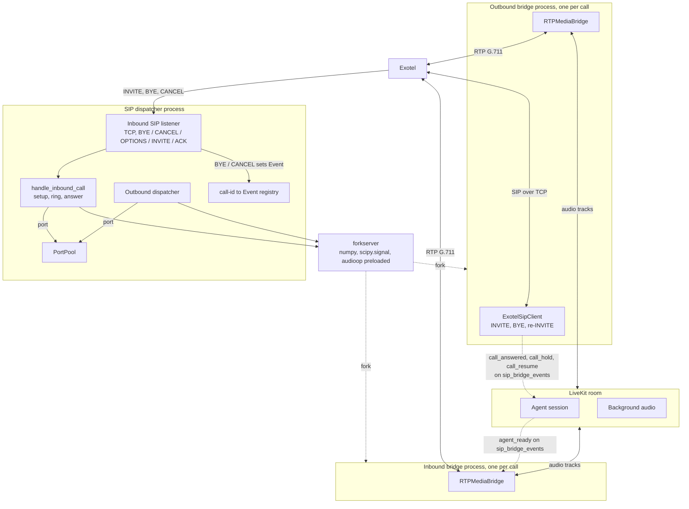
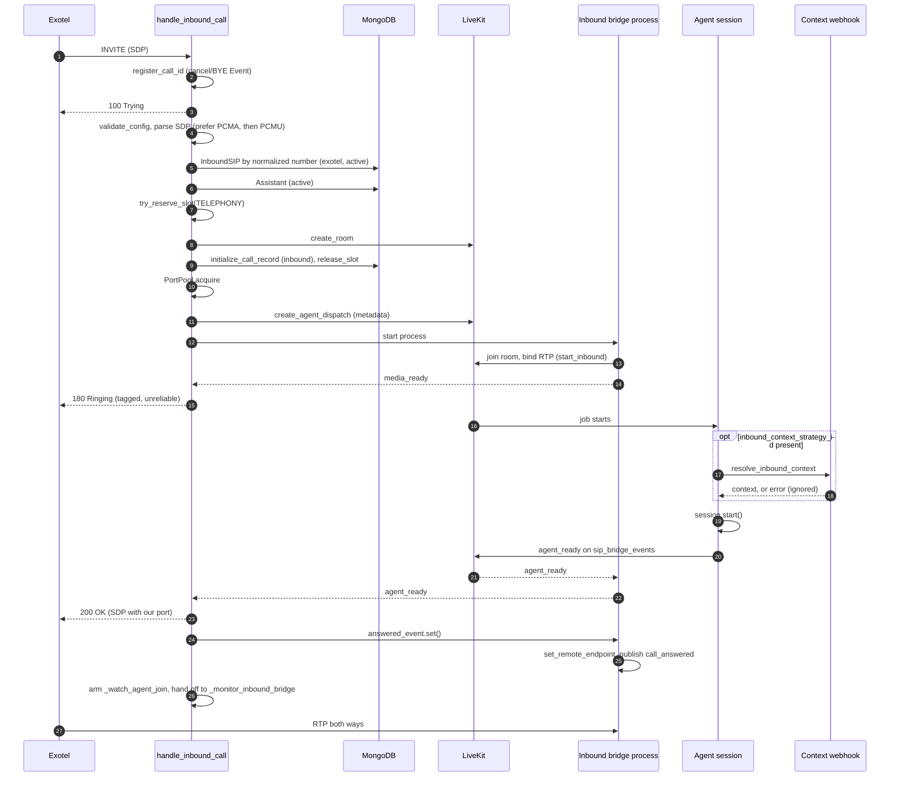
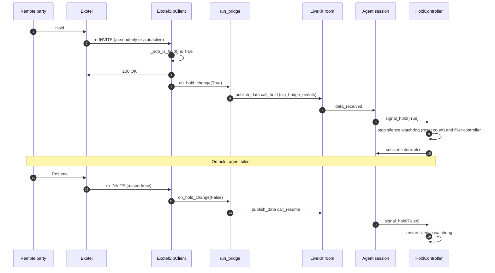
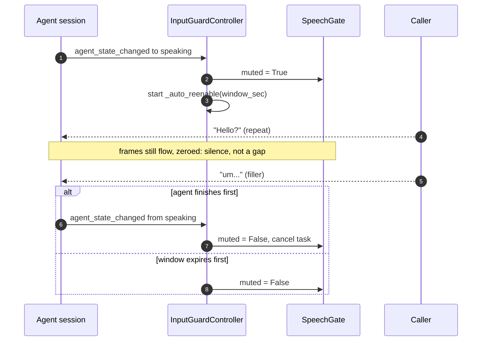

# Telephony (Exotel)

Behaviour as callers and API users see it (ringing, SIP response codes, hold, the input guard
field): [Call lifecycle](../../docs/concepts/call-lifecycle.md). This page explains the custom SIP
and RTP bridge the platform runs for Exotel, the audio processing on both sides of it, and the
agent-side mechanics that depend on it (speech gate, hold, input guard).

Twilio calls do not use any of this: they are LiveKit's managed SIP participant, created with
`create_sip_participant` (see [Dispatcher and queue](dispatcher-and-queue.md)).



## Process layout

The SIP dispatcher process (`sip_dispatcher_run.py`, or the API server in dev) owns two things:
the inbound SIP listener and the outbound dispatcher. The media half of every call, inbound and
outbound, runs in its own OS process.

### Why one process per bridge

The LiveKit Python SDK talks to a process-wide Rust FFI singleton (`FfiClient`). Its event
dispatch walks every subscriber under one lock on one thread, and `AudioSource.capture_frame`
subscribes a fresh queue for each frame. A bridge calls it once per RTP packet, 50 times a second
per call. With many calls in one process the cost of every event grows with the number of calls:
the native queue overflows (`native audio stream queue overflow; dropped N queued frames`), the
signal client misses pings, and agent audio stops reaching the caller while the server-side
recording still captures both sides perfectly. A separate process gets its own FFI library and
its own queue, so calls cannot contend.

### Why forkserver

`get_bridge_context()` returns a `forkserver` multiprocessing context with `numpy`,
`scipy.signal` and `audioop` preloaded, and falls back to `spawn` if forkserver is unavailable.
Under `spawn` every child re-imported scipy (seconds of CPU each); at a dozen simultaneous calls
that burst starved the dispatcher's event loop. Measured on 8 concurrent bridges, forkserver cut
startup from ~1.45 s to ~0.68 s each and total RSS from 869 MiB to 605 MiB, because preloaded
pages are shared copy-on-write.

Three rules follow:

- **`livekit.rtc` is never preloaded.** Importing it starts the native FFI callback thread, and a
  child forked from a process with live native threads gets a broken FFI. Each bridge imports it
  after the fork.
- **Arguments must be picklable.** The fork happens in the clean forkserver helper, not in the
  dispatcher, so no asyncio state is inherited, but everything passed still crosses a process
  boundary.
- **Every multiprocessing object comes from the same context.** An `Event` or `Queue` from the
  default context, handed to a forkserver child, fails with *"A SemLock created in a fork context
  is being shared with a process in a spawn context."* `register_call_id` and the dispatcher both
  build theirs from `get_bridge_context()`.

### What crosses the process boundary

| Resource | Owner | How it is shared |
|---|---|---|
| RTP port number | Parent (`PortPool`) | `int` argument; the parent releases it after reaping the child |
| `call_id` | Parent (outbound: a fresh UUID; inbound: Exotel's Call-ID) | `str` argument; the registry key in the listener |
| BYE / CANCEL signal | Parent (registered in the listener) | `multiprocessing` `Event`; the child polls it |
| Setup result (outbound) | Child | `multiprocessing.Queue`; the parent polls every 500 ms |
| `media_ready` / `agent_ready` / `failed` (inbound) | Child | `multiprocessing.Queue` read by `_wait_for_event` |
| Answer (inbound) | Parent | `answered_event`; the child gates media on it |

The parent always reaps the child (join, then SIGKILL after 3 s) before releasing the port, so a
zombie never holds a UDP socket the pool has handed to a new call.

## The inbound SIP listener

`ensure_inbound_server()` starts a TCP SIP server. Each connection is parsed by
`_handle_inbound_sip()`:

| Request | Handling |
|---|---|
| `INVITE` | `_run_invite()` runs `handle_inbound_call()` inside the `MAX_CONCURRENT_INVITE_SETUPS` semaphore, as a task kept in `_invite_tasks`. An unhandled exception answers `500 Server Internal Error`, so an INVITE never goes unanswered. |
| `BYE` | Look up the call's Event and set it; reply `200 OK`. Exotel may send BYE on a different connection, or from a different node, than the INVITE, which is why the signal goes through a registry and not the original socket. |
| `CANCEL` | Same Event as BYE: the caller hung up before answer. `handle_inbound_call` sees it and replies `487` on the INVITE's own connection. |
| `OPTIONS` | `200 OK` (keep-alive). |
| `ACK` | Logged. |

Nothing handles `PRACK`. If `EXOTEL_SIP_ALLOWED_IPS` is set, connections from other addresses are
closed.

The registry key is `"<peer_ip>|<call_id>"` for inbound calls (Call-IDs come off the wire) and the
bare UUID for outbound. A missing Call-ID raises `ValueError` and a key already live raises
`DuplicateCallId`; both answer `400 Bad Request` instead of overwriting the first call's Event,
which used to leave that call unable to receive its BYE.

## Inbound call setup

`handle_inbound_call()` runs on the listener's event loop and returns once the call is answered.



Points that are easy to get wrong:

- **The cancellation Event is registered first**, before any database or LiveKit work, so a
  CANCEL that arrives during setup is not lost. `cancel_event.is_set()` is checked after every
  slow step and throughout the ring; a hit answers `487 Request Terminated`. The same Event later
  carries the post-answer BYE.
- **The To-tag is minted once** (`inbound-<12 hex>`), before the 180, and reused by the 200 OK and
  by every rejection after the 180. A 1xx with a To-tag opens an early dialog that the 2xx must
  confirm; two different tags read as two dialogs and break ACK routing and CANCEL matching.
  Rejections sent before the 180 carry no tag.
- **The 180 is unreliable**: no `Require: 100rel`, no `RSeq`, because nothing here would answer
  a PRACK.
- **Ring until the agent is ready.** The bridge process first binds its RTP socket and joins the
  room, then reports `media_ready`. Answering before that would point Exotel's RTP at a port
  nothing listens on. The 200 OK then waits for `agent_ready`, which the agent publishes after
  `session.start()` returns, so after tool loading, TTS prewarm and the inbound-context webhook.
  The signal is advisory: the bridge process also treats the agent's audio track being subscribed
  as ready, and the parent answers anyway after `INBOUND_MAX_RING_SECONDS` (default 15). A slow
  agent delays the answer; it never drops the call. `INBOUND_RING_UNTIL_AGENT_READY=false`
  answers on `media_ready` instead. `INBOUND_MEDIA_READY_TIMEOUT` (default 20 s, above the
  bridge's 15 s LiveKit connect timeout) bounds the first wait.
- **The silent-agent watchdog is armed after the 200 OK**, with `already_answered=True`. Inbound
  never writes `call_status="answered"`; the 200 OK is the answer. Arming it earlier let its 15 s
  grace run out during the ring and kill healthy calls.
- **The handler returns after answering.** `_monitor_inbound_bridge()` owns the process from
  there and releases the port and registry entry however it ends, so a live call does not hold an
  INVITE setup slot.
- **Dispatch metadata** carries `call_type="inbound"`, `service`, `assistant_id`,
  `assistant_name`, `inbound_id`, `inbound_context_strategy_id`, `inbound_number` and
  `caller_number`. The agent uses the strategy id to call the webhook before rendering the prompt.

### Inbound failure paths

| Response | Cause | Cleanup |
|---|---|---|
| `400 Bad Request` | Missing or duplicate Call-ID; no RTP address or port in the SDP | Unregister |
| `503 Service Unavailable` | `validate_config()` fails | Unregister |
| `480 Temporarily Unavailable` | No active `InboundSIP` mapping (or no `assistant_id` on it); assistant missing or inactive | Unregister |
| `486 Busy Here` | `try_reserve_slot` refused; `PortPool.acquire()` raised `RuntimeError` (pool exhausted) | Unregister |
| `500 Internal Server Error` | `create_room`, `initialize_call_record` or `create_agent_dispatch` failed | Release slot or port as held |
| `487 Request Terminated` | CANCEL seen at any checkpoint, including while ringing | `_abandon` after the process started |
| `503 Service Unavailable` | Bridge never reported `media_ready` (timeout, `failed` event, or process died) | `_abandon` |

`_abandon()` terminates and reaps the bridge process, replies, releases the port, then calls
`end_call()` and `delete_room()` because an agent has already been dispatched and would otherwise
leak. A missing or failing context strategy never fails the call: the worker logs it and renders
the default prompt.

After answer, an inbound call ends on BYE (the shared Event), a LiveKit disconnect,
no RTP at all for `NO_RTP_AFTER_ANSWER_SECONDS` (60), or RTP silence for
`RTP_SILENCE_TIMEOUT_SECONDS` (30) after audio had been flowing.

## Outbound Exotel bridge

`_bridge_subprocess_entry()` (in `bridge.py`) runs `run_bridge()` in the child. The dispatcher
side, including the 60 s setup monitor, is in [Dispatcher and queue](dispatcher-and-queue.md).

- `ExotelSipClient` sends the INVITE over TCP with digest auth and reports the outcome on the
  result queue (`success`, `call_status`, `sip_status_code`, `sip_status_text`, `error`).
- Audio tracks subscribed **before** the 200 OK are queued, not mixed; on answer each gets a fresh
  stream, so pre-answer audio never leaks to the callee. Passthrough is the exception: on a 183
  with SDP, inbound RTP (phone to web) is unlocked so the web user hears ringback and busy tones,
  while the web-to-phone direction stays blocked until answer.
- On answer the bridge publishes `{"event": "call_answered"}` on `sip_bridge_events`.
- The call ends on the first of: BYE on the SIP client's own connection
  (`sip_bye_outbound_tcp`), BYE through the listener's Event (`sip_bye_inbound_tcp`), LiveKit
  disconnect, `no_rtp_after_answer` (60 s, recorded as `failed`), or `rtp_silence_after_flow`
  (30 s).

### Agent-side gating for Exotel calls

The agent session must not speak or record before the callee answers.

- The `data_received` listener for `sip_bridge_events` is registered **before** `session.start()`.
  `session.start()` can take 10 s or more, and a data packet has no buffering or replay, so a
  `call_answered` arriving with nobody listening is lost for good.
- `call_answered` marks the `CallReadinessGate`; on outbound it also starts recording
  (`RecordingManager.start_once`) and writes `answered`.
- `_wait_to_speak_or_hangup()` waits for the gate (60 s), for recording to start (12 s), then
  `EXOTEL_RTP_WARMUP_SLEEP_SEC` (0.25 s, not yet verified on a live call: raise it if the first
  word sounds clipped), and races all of it against the participant hanging up. It logs one
  `[EXOTEL] phase timing` line.
- Before the answer the line carries the ring tone, which every model hears as speech. On the
  greeting path a realtime model's `turn_detection` is set to `None` when interruptions are off;
  cascade (interruptions off) and duplex mute the `SpeechGate` instead. Without a greeting,
  `_mute_until_answered()` mutes the gate until the answer or a 60 s timeout.
- `should_record()` keeps assistant lines out of the transcript before the answer and during
  hold, but always keeps the caller's lines: one dropped `call_answered` packet must not discard
  a whole call's transcript.

## RTP port pool

Each call binds one UDP socket. `PortPool` steps by 2 so `port+1` stays free for RTCP: a range of
N ports serves N/2 calls.

| Setting | Default | Notes |
|---|---|---|
| `SIP_BRIDGE_PORT_RANGE_START` / `RTP_PORT_START` | `41000` | `SIP_BRIDGE_PORT_RANGE_*` wins if both are set |
| `SIP_BRIDGE_PORT_RANGE_END` / `RTP_PORT_END` | `42000` | 500 concurrent calls at the default |
| `PortPool.COOLDOWN_SECONDS` | `30` | A released port is not reused before this |

Ports are handed out round-robin, so the whole range cycles before a port comes back, and the
cooldown keeps RTP still in flight from an ended call away from a new one. The RTP socket also
drops every packet whose source is not the endpoint negotiated in the SDP; it never learns its
peer from the first packet. Both exist because one caller once heard another call.

The range must be open for UDP in the firewall (AWS Security Group). A closed range shows as a
call with no audio either way and `[RTP] ZERO inbound packets` in the logs. Keep it clear of
LiveKit SIP's `10000-40000` and LiveKit RTC's `50000-60000`: if two services bind the same UDP
port, audio goes to whichever bound last.

## Audio pipeline

### Phone to agent (RTP in)

PSTN audio is G.711 at 8 kHz, narrow-band (300–3400 Hz). Fed raw, the STT model hallucinated
(random scripts such as Urdu or Hebrew). `_decode_rtp_payload()` processes each packet:

```text
RTP packet
    ↓  return nothing unless payload type is PCMA (8) or PCMU (0)
    ↓  audioop.alaw2lin / ulaw2lin
PCM int16 at 8 kHz
    ↓  Butterworth high-pass, 80 Hz, order 2, stateful (sosfilt zi carried across packets)
DC offset and hum removed, full speech band kept
    ↓  resample_poly(up=6, down=1) with a pinned 121-tap Kaiser FIR, 20-sample history carried
PCM at 48 kHz, anti-aliased at 4 kHz
    ↓  np.tanh(samples × 1.5)
quiet speech boosted, peaks soft-clipped
    ↓
int16 at 48 kHz to the LiveKit AudioSource
```

| Choice | Why |
|---|---|
| Drop non-G.711 payloads | PT 101 (RFC 2833 DTMF), comfort noise and other dynamic types decode to garbage PCM that pollutes STT. |
| 80 Hz high-pass, not a 300–3400 Hz bandpass | Male fundamentals are 80–150 Hz; a 300 Hz cut strips the root pitch and sounds hollow. The upper cut is redundant with the resampler, and a 4th-order bandpass smears consonants with non-linear group delay. |
| Stateful filter | Restarting the IIR every 20 ms packet clicks at each boundary, heard as a 50 Hz buzz. |
| `resample_poly`, not `audioop.ratecv` | Linear interpolation images the 8 kHz signal across the 48 kHz spectrum; STT sees a wrong signal. The FIR is pinned so a SciPy upgrade cannot change it. |
| `tanh` instead of fixed gain plus `np.clip` | A fixed 3× gain clipped loud speech, and hard clipping makes harmonics STT reads as fricatives. `tanh` is a soft limiter: near-linear below ~0.5. |
| No noise suppression here | WebRTC NS here shifted the spectrum OpenAI's `far_field` mode expects, and its AGC amplified the agent's own echo into false barge-ins. Noise handling lives in the agent (`SpeechGate`), where one implementation covers phone and web. |

Incoming RTP goes through a bounded queue (~1 s at 50 packets/s) that drops the oldest packet on
overflow, so playback cannot drift behind real time.

### Agent to phone (RTP out)

Every subscribed audio track (the agent's voice and the background-audio track) feeds an
`rtc.AudioMixer` (48 kHz mono, 10 ms blocks, silence after 20 ms of a missing frame).
`_send_frame()` then:

```text
mixed int16 PCM at 48 kHz
    ↓  np.tanh(samples × 0.7)      about 3 dB headroom, soft limit
    ↓  resample_poly(up=1, down=6) anti-aliased at 4 kHz
    ↓  accumulate 20 ms (ptime=20)
    ↓  audioop.lin2alaw / lin2ulaw  160-byte payload
    ↓  RTP header, sendto(negotiated endpoint)
```

TTS engines normalise near 0 dBFS, which distorts on the G.711 companding curve and sounds too
loud on a phone. Without the FIR, energy above 4 kHz folds back as metallic hiss.

The same generic `track_subscribed` handler is why passthrough needs no special case: the web
user's microphone track is mixed and sent to the phone exactly like an agent's voice.

### Input speech gate

`SpeechGate` (in `audio_denoise.py`) is an `rtc.FrameProcessor` that runs on the caller's audio
inside the agent process, on web and phone calls alike. It exists because nothing else could stop
background noise from interrupting the agent on this deployment:

| Constraint | Consequence |
|---|---|
| Self-hosted LiveKit | Cloud noise cancellation (BVC, Krisp) is unavailable, and the SDK skips adaptive interruption off Cloud. |
| `turn_detection="realtime_llm"` (pipeline mode) | VAD-based interruption returns early; `min_duration` / `min_words` interruption knobs never run, so `session.py` does not set them. |
| The realtime model's own VAD | `_on_input_speech_started` interrupts unconditionally on its speech-start, with no threshold. |

`AudioInputOptions.noise_cancellation` accepts a `FrameProcessor`, which runs in-process inside
`rtc.AudioStream`: neither Cloud-gated nor bypassed by `realtime_llm`. The gate sits there, so it
filters audio before the model's VAD can fire.

```text
caller audio (mono, the rate RoomIO delivers, 24 kHz by default)
    ↓  rtc.AudioProcessingModule(noise_suppression, high_pass_filter)   about -11 dB on stationary noise
    ↓  rtc.AudioResampler: 16 kHz COPY for the VAD only; the frame keeps its own rate
    ↓  Silero VAD v5 (ONNX, CPU, one thread, 512-sample windows + 64-sample context)
    ↓  speech if any window in the frame scores >= 0.5; 600 ms hangover
    ↓  non-speech frames zeroed
the model hears silence during noise, so it cannot fire speech-start
```

- **A gate, not just a denoiser.** A denoiser lowers the noise level and the model's VAD still
  fires on what is left. Only a speech classifier can decide the audio is not the caller.
- **AGC is off.** `AudioInputOptions.auto_gain_control` defaults to `True`; passing a bare
  `audio_input=True` left it on. It is the same AGC that re-amplified agent echo into false
  barge-ins, so `session.py` sets it to `False` explicitly.
- **Silero needs its context.** Each inference takes `context + window` (64 + 512 samples at
  16 kHz), the context being the previous window's tail. A bare 512-sample window scores ~0.0 for
  everything, including clear speech, and raises nothing, because the ONNX graph has a dynamic
  input shape. `tests/test_audio_denoise.py` checks both directions.
- **One instance per stream.** The APM and the VAD are stateful. The session's audio input gets
  one, and the Sarvam parallel STT tap (`stt/sarvam_parallel.py`) builds its own `AudioStream` with
  another, or it would transcribe raw noise. That tap still sends gated frames, as silence, and
  counts them as usage.
- **Guard against double application.** RoomIO hands the same instance to the SDK twice, as the
  input stream's `processor` and as the `AudioStream`'s `noise_cancellation`. Processing a frame
  twice is not just waste: the second pass scores the zeroed samples as silence and drains the
  hangover twice as fast (600 ms behaves as 300 ms), so the model endpoints mid-sentence. `_process`
  keeps a strong reference to the last frame (not `id()`, which a freed frame can alias) and
  returns a repeat untouched. Pinned by `test_hangover_is_unaffected_by_the_sdks_double_application`.
- **Calibration** is three constants at the top of `audio_denoise.py`: `_THRESHOLD` (0.5),
  `_HANGOVER_MS` (600), `_ATTENUATION` (0.0, a hard gate). Lower the threshold if quiet callers
  are clipped, raise it if noise still gets through. Every false positive holds the gate open for
  the full hangover.

Measured on 33 s of telephone-band speech, with `assets/audio/*_48k.wav` as noise:

| Input | Speech energy kept | Frames passed |
|---|---|---|
| Telephone-band speech | 94.6% | 79% (the rest is silence between sentences) |
| Speech mixed with office ambience | 88.0% | 88% |
| Office ambience alone | — | 18% (the fixture contains real background voices) |
| Keyboard typing | — | 0% |
| White noise | — | 0% |

Decisions are identical at 16, 24 and 48 kHz input, because the VAD always sees the same 16 kHz
copy. Cost is under 2 ms per 50 ms frame (NS ~0.1 ms, Silero ~1 ms per 32 ms window), about 1
core-% per stream, with no buffering or lookahead. Onset is detected within one frame, and the
whole frame opens if any window in it is speech. Limits: a television or a second person is
speech; separating them needs speaker identification. Filler sounds ("um", 200–400 ms) are
speech too; on a quiet line bursts under ~400 ms happen to be rejected, over ambience even 200 ms
passes. That is the input guard's job.

Dependencies: `scipy`, `numpy`, `onnxruntime` (Silero). WebRTC NS comes from
`rtc.AudioProcessingModule` in `livekit-rtc`. The Silero model is vendored at
`src/core/agents/models/silero_vad.onnx` (2.2 MB, MIT) and ships with `COPY src`. The agent image
installs from `docker/requirements-agent.txt`, not `pyproject.toml`, and lacks the `turn-detector`
extra that would pull in `onnxruntime`, so `onnxruntime` is listed there explicitly. A runtime
dependency added only to `pyproject.toml` is an `ImportError` in production.

### Transcription noise-reduction profile

`noise_reduction_for()` picks OpenAI's `input_audio_noise_reduction` for every OpenAI realtime
branch (pipeline and realtime): `far_field` for phone calls, `near_field` otherwise.
`build_native_stt_prompt()` adds a phone-line note to the transcription prompt on phone calls
("Audio is from a live telephone call (G.711 narrowband, ~8 kHz, lossy). Expect static, line hum,
codec artifacts, and muffled consonants...") so the model does not invent words on unintelligible
audio. "Phone call" is `is_phone_call(call_type)`, a positive test: meeting audio is wideband and
gets `near_field` and no phone note, like web. `near_field` on phone audio measurably hurt
transcription. Gemini takes no transcription prompt, so neither applies there.

## Hold and resume

Hold detection exists only where the platform holds the SIP dialog's client side: **outbound
Exotel calls**.



While `hold_controller.is_on_hold`:

| Handler | Behaviour |
|---|---|
| `conversation_item_added` | Interrupts assistant speech; drops assistant lines from the transcript; still saves caller lines (`should_record`); no filler-context or watchdog side effects |
| `user_state_changed` | Returns early: no filler or silence-watchdog triggers |
| `agent_state_changed` | `session.interrupt()` if the agent starts speaking |

Inbound Exotel calls have no hold detection: an in-dialog re-INVITE reaches the inbound listener,
which only knows new INVITEs, and the duplicate Call-ID is refused. Twilio calls have none either.

## Per-utterance input guard

Phone callers repeat themselves while the agent replies ("Hello… Hello?"). Each repeat is real
speech of 0.9 s or more, so neither the gate nor a duration filter (which `realtime_llm` would not
run anyway) stops it. The framework treats it as a barge-in, the agent fragments its sentence, the
LLM apologises, and the loop repeats ("Sorry, I'm here / Yes, I'm…"). Filler sounds cause the
same thing.

`InputGuardController` blanks the caller for the first `input_guard_window_sec` of every agent
utterance by setting `SpeechGate.muted = True`. Muting zeroes frames while the stream keeps
flowing. Detaching the input (`session.input.set_audio_enabled(False)`) instead makes
`_ParticipantInputStream._forward_task` drop frames outright, and a realtime model expecting a
continuous feed (notably Gemini Live) can misbehave on the gap. The cost of muting is that the
model is billed for the silent audio. The gate's VAD still runs on the real audio while muted, so
its hangover state stays correct.

| Event | Action |
|---|---|
| Agent state becomes `speaking` | `muted = True`; schedule `_auto_reenable` after the window |
| Agent leaves `speaking` before the window ends | Cancel the task, unmute now |
| Window expires while still speaking | Unmute; the caller can interrupt a long answer |
| Call teardown (`_flush_and_end_call`) | `aclose()` cancels the task and unmutes |



The guard is built only when there is audio, the window is above zero, and the mode is not
duplex:

```python
speech_gate = None if is_text_only else SpeechGate()
...
input_guard = None if (speech_gate is None or _guard_window <= 0 or is_duplex) else InputGuardController(
    logger=logger, gate=speech_gate, window_sec=_guard_window,
)
```

Duplex is excluded because GPT-Live listens while it speaks and decides its own turns; blanking
the caller would deafen it exactly when a barge-in or backchannel matters. Realtime mode, Gemini
included, is covered. Not yet confirmed on a live Gemini realtime call: that Gemini Live tolerates
a 3 s silent stretch mid-session.

On the greeting, the guard overlaps with the greeting path's own pre-answer handling (above);
the guard's real work is on later replies. Trade-off: the caller cannot interrupt in the first
seconds of any reply. Short replies usually end inside the window and unmute at once.

## Where in the code

| What | File | Symbol |
|---|---|---|
| Inbound listener, registry | `src/services/exotel/custom_sip_reach/inbound_listener.py` | `ensure_inbound_server`, `_handle_inbound_sip`, `_run_invite`, `register_call_id`, `register_call_id_with_event`, `unregister_call_id`, `DuplicateCallId` |
| Inbound setup, ring, answer | `src/services/exotel/custom_sip_reach/inbound_bridge.py` | `handle_inbound_call`, `_wait_for_event`, `_monitor_inbound_bridge`, `RING_UNTIL_AGENT_READY`, `MAX_RING_SECONDS`, `MEDIA_READY_TIMEOUT` |
| Inbound media process | `src/services/exotel/custom_sip_reach/inbound_worker.py` | `inbound_bridge_subprocess_entry`, `_run_inbound_bridge` |
| Outbound bridge process | `src/services/exotel/custom_sip_reach/bridge.py` | `_bridge_subprocess_entry`, `run_bridge` |
| SIP client, hold parsing | `src/services/exotel/custom_sip_reach/sip_client.py` | `ExotelSipClient`, `_sdp_is_hold` |
| RTP and DSP | `src/services/exotel/custom_sip_reach/rtp_bridge.py` | `RTPMediaBridge` (`start_inbound`, `_on_rtp_readable`, `add_outbound_track`, `_send_frame`), `_decode_rtp_payload` |
| Port allocation | `src/services/exotel/custom_sip_reach/port_pool.py` | `PortPool`, `get_port_pool` |
| Bridge env settings | `src/services/exotel/custom_sip_reach/config.py` | `RTP_PORT_START`, `RTP_PORT_END`, `NO_RTP_AFTER_ANSWER_SECONDS`, `RTP_SILENCE_TIMEOUT_SECONDS`, `EXOTEL_SIP_ALLOWED_IPS`, `validate_config` |
| Process context | `src/services/outbound_dispatcher/dispatcher.py` | `get_bridge_context`, `_reap_bridge` |
| Speech gate | `src/core/agents/audio_denoise.py` | `SpeechGate`, `_THRESHOLD`, `_HANGOVER_MS`, `_ATTENUATION` |
| Hold, input guard | `src/core/agents/voice_features.py` | `HoldController`, `InputGuardController` |
| Answer gating, hold events, `agent_ready` | `src/core/agents/session.py` | `entrypoint`, `_wait_to_speak_or_hangup`, `_mute_until_answered`, `should_record`, `EXOTEL_RTP_WARMUP_SLEEP_SEC` |
| Readiness gate, recording | `src/core/agents/session_lifecycle.py` | `CallReadinessGate`, `RecordingManager` |
| Noise-reduction profile, phone prompt | `src/core/agents/stt/native_prompt.py` | `noise_reduction_for`, `build_native_stt_prompt` |
| Phone-call test | `src/core/call_types.py` | `is_phone_call` |
| Sarvam tap's own gate | `src/core/agents/stt/sarvam_parallel.py` | `SpeechGate` use in the tap's `AudioStream` |
| Inbound context webhook | `src/core/agents/inbound_context.py` | `resolve_inbound_context` |
| Inbound mappings | `src/core/db/db_schemas.py` | `InboundSIP` |
