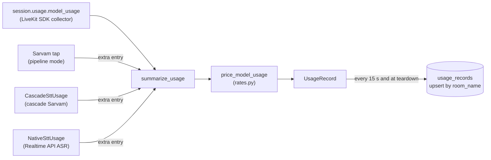

# Usage and pricing

How the worker collects what each call used, folds it into one `UsageRecord`, and prices it. What
the fields mean to a user is on the public pages:
[Usage Accounting](../../docs/reference/usage-accounting.md) and
[Pricing](../../docs/reference/pricing.md).

## The flow

## Collection

The LiveKit agents SDK collects usage itself from the plugin metrics of every component the
`AgentSession` owns, and exposes it as `session.usage.model_usage`: one entry per
`(provider, model)` pair. `summarize_usage` in `src/core/agents/usage.py` reads that list and
returns the `UsageRecord` field values. It never raises: on any failure it degrades to zeros,
because usage is not worth losing a call record over.

Three transcription paths do not reach the collector correctly, so each one measures itself and
hands `summarize_usage` an extra entry shaped exactly like the SDK's own (`extra_usage`):

- **Pipeline Sarvam tap** (`run_sarvam_parallel_stt` in `src/core/agents/stt/sarvam_parallel.py`).
  The tap builds its own plugin STT and never hands it to the session, so the collector never
  sees it. `SttUsage` sums the duration of every frame pushed. The `DRAIN_SILENCE_S` burst sent
  at hangup takes a different path and is not counted.
- **Cascade Sarvam** (`src/core/agents/stt/cascade_usage.py`). The STT is a real session stage, but
  the plugin's figure comes from `metrics.audio_duration`, which the server often omits (default
  `0.0`), and no event is emitted for an empty transcript. `DynamicAssistant.stt_node` counts the
  frames the session hands the stage into `CascadeSttUsage`. `MeteredSarvamSTT` drops the
  plugin's own `metrics_collected`; it must drop rather than zero it, because the collector
  creates an entry from the first metric it sees and `summarize_usage` sums every entry, so a
  zeroed one would sit beside the measured one and count the audio twice. Other cascade STT
  providers are left alone: Cartesia, Deepgram and ElevenLabs count frames themselves, and
  OpenAI reports billing tokens.
- **Realtime API ASR** (`src/core/agents/stt/native_usage.py`). OpenAI reports transcription usage
  on every `conversation.item.input_audio_transcription.completed` event, but the plugin keeps the
  transcript and drops the usage. `MeteredRealtimeModel` reads it off the plugin's raw
  `openai_server_event_received` stream into `NativeSttUsage`, under the model
  `gpt-4o-mini-transcribe`.

All the frame-counting paths measure stream time, not speech time: `SpeechGate`
(`src/core/agents/audio_denoise.py`) zeroes non-speech samples in place and returns the same frame,
so gated audio is still sent and still counted.

### Provider names

`normalize_provider` lowercases the provider string the SDK reports and maps any
`*.openai.com` host to `openai`. The pricing tables are keyed on these normalized names; Gemini is
keyed under `gemini`, which is what the plugin reports for an API-key session.

## Writing the record

`_persist_usage` inside `entrypoint()` (`src/core/agents/session.py`) builds the `UsageRecord`,
then `upsert_usage_record` writes it by `room_name`:

- every `USAGE_FLUSH_INTERVAL_S` (`15.0`) while the call runs, skipped when the snapshot (without
  `call_duration_minutes`, which grows on the wall clock) has not changed since the last write;
- once at teardown with `usage_finalized=True`. This write is authoritative.

`stt_provider` is set from where transcription was billed: the cascade STT stage, the Sarvam tap,
or `openai` when a Realtime ASR entry exists. Gemini realtime has none, because its input audio is
inside the LLM tokens.

## Pricing

`price_model_usage` (`src/core/pricing/calculator.py`) prices each billable entry with
`get_rate(component, provider, model)` from `src/core/pricing/rates.py`. It is a pure function over
the entry list.

- An entry with no rate is kept and marked `pricing_complete: false`, never priced as free. The
  record's `pricing_complete` is false when any entry is unpriced.
- An OpenAI LLM entry on a `service_tier` other than `auto`/`default` is left unpriced, because the
  table holds standard-tier rates only.
- A dated snapshot name (`gpt-5.6-luna-2026-04-23`) falls back to its alias's rate only for
  reasoning models plus the two retired in 1.6.0, because older snapshots can carry a different
  price.
- `PRICING_SCHEMA_VERSION` is written into every record so a stored estimate can be reproduced.

The rates are public pay-as-you-go list prices. Two are weaker than the rest and say so in
`rates.py`: Cartesia is derived from its plan tiers, and Deepgram is priced at its regular rate.

### Keeping the public page in sync

`docs/reference/pricing.md` is hand-written. `tests/test_provider_pricing.py` fails when a rated
model is missing from it (`test_every_rated_model_is_on_the_pricing_page`), and when an
allowlisted model has no rate (`test_every_allowlisted_openai_llm_has_a_rate` and the
ElevenLabs, Sarvam, Cartesia, Mistral and Gemini equivalents). When a rate changes, change it in
`rates.py` and on the page, with the date it was checked, then run
`uv run python -m unittest tests/test_provider_pricing.py`.

## Where in the code

| What | File | Symbol |
|---|---|---|
| Fold SDK usage into record fields | `src/core/agents/usage.py` | `summarize_usage`, `normalize_provider`, `upsert_usage_record` |
| Periodic and final write | `src/core/agents/session.py` | `_persist_usage` (inside `entrypoint`), `USAGE_FLUSH_INTERVAL_S` |
| Record schema | `src/core/db/db_schemas.py` | `UsageRecord` |
| Pipeline Sarvam tap metering | `src/core/agents/stt/sarvam_parallel.py` | `run_sarvam_parallel_stt`, `SttUsage`, `DRAIN_SILENCE_S` |
| Cascade Sarvam metering | `src/core/agents/stt/cascade_usage.py`, `src/core/agents/dynamic_assistant.py` | `CascadeSttUsage`, `MeteredSarvamSTT`, `DynamicAssistant.stt_node` |
| Realtime ASR metering | `src/core/agents/stt/native_usage.py` | `NativeSttUsage`, `MeteredRealtimeModel` |
| Noise gate | `src/core/agents/audio_denoise.py` | `SpeechGate` |
| Price calculation | `src/core/pricing/calculator.py` | `price_model_usage`, `PricingResult` |
| Rate tables | `src/core/pricing/rates.py` | `get_rate`, `OPENAI_RATES`, `GEMINI_LIVE_RATES`, `PRICING_SCHEMA_VERSION` |
| Pricing page sync test | `tests/test_provider_pricing.py` | `test_every_rated_model_is_on_the_pricing_page` |
