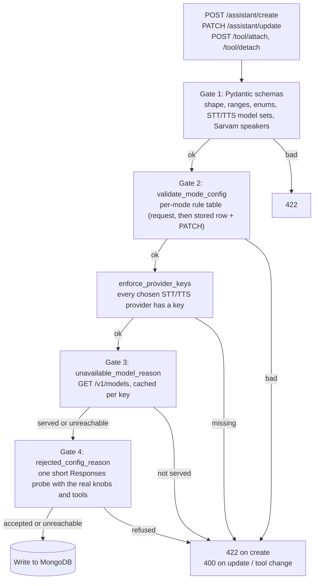

# Validation and model support

Every check that decides whether an assistant configuration can run a call. The checks exist to
prevent one failure: a configuration that is accepted, then refused by OpenAI on **every** LLM
turn, so the call connects and the caller hears silence. Over the WebSocket the runtime uses,
that refusal arrives as `status_code=-1` with no parameter name, so nothing in the logs says what
was wrong.

What the user sees (which combinations are legal, what each error looks like) is on the public
pages: [Compatibility Matrix](../../docs/reference/compatibility.md),
[Models & Providers](../../docs/reference/models.md) and
[Troubleshooting](../../docs/reference/troubleshooting.md). This page explains how the checks are
built.

## The four gates

The gates run cheapest first. Gates 1 and 2 are offline; gates 3 and 4 make a network call.

1. **Pydantic** (`src/api/models/api_schemas/`). Shape, ranges and enums, plus the STT and TTS
   model sets, the Sarvam speaker rosters and the ElevenLabs settings each model reads. Every
   provider config has `extra="forbid"`, so a typo is a `422`.
2. **`validate_mode_config`** (`src/api/models/api_schemas/config/llm_config.py`). One rule table
   for all four modes: which provider, which model list, which voice, which STT, whether a TTS
   pair is required, which generation knobs the model reads, and the `tool_choice` rule. The
   `CreateAssistant` and `UpdateAssistant` validators call it on the request alone.
3. **`unavailable_model_reason`** (`src/core/model_support/openai_live.py`). Does the account
   behind this key still serve the model? One `GET /v1/models`. No static list can know about a
   retirement: three `*-chat-latest` aliases were retired on 2026-06-19 and every assistant
   holding one kept validating clean.
4. **`rejected_config_reason`** (same module). Will OpenAI accept this exact request? One short
   Responses call with the real model, knobs and tool schemas (`store: false`, reply capped at
   16 tokens). This catches a `reasoning_effort` value the model refuses, a `service_tier` the
   account may not use, and a tool schema the API rejects. OpenAI's own message becomes the
   error detail.

`enforce_openai_config` in `src/api/validation/assistant_guard.py` runs gates 3 and 4. Gate 3
runs for every OpenAI model (realtime, cascade, GPT-Live and the duplex `backend_model`). Gate 4
runs only where turns go to the Responses API: the cascade model, and the duplex backend model.
Gemini skips both: there is no `/v1/models` equivalent and no cheap probe, so Gemini Live ids are
checked only against the static list.

### Fail open, and caching

Gates 3 and 4 fail **open** on anything that is not a clear refusal: network error, `401`, `429`,
`5xx`. The write is allowed and a warning is logged. An OpenAI outage must not make assistants
uneditable, and the static allowlist has already had its say.

Both answers are cached in process memory, per key, for `OPENAI_MODEL_CACHE_TTL` seconds (default
`3600`). The cache key is a SHA-256 fingerprint of the API key, never the key itself, because the
cache can end up in a memory dump. The probe cache is keyed by key fingerprint plus a signature of
the gated knobs (`gated_knob_signature` in `payload.py`), so one probe is sent per distinct
combination per hour. A retirement therefore lands within an hour without a deploy.
`clear_cache()` drops both caches (tests use it).

These checks live at route level, not in a Pydantic validator, because validators are
synchronous and a network call inside one would block the event loop.

### 422 versus 400

Create answers `422`: the request named the bad value. Update and tool changes answer `400`: the
request is well-formed, but the value that breaks the assistant may have come from the stored
row.

## Re-checking against the stored row

Most PATCHes do not resend `assistant_mode`, and the schema validator only sees the request. So
`enforce_stored_mode_constraints` merges the stored row with the PATCH (`effective_llm_config`,
`effective_value`) and runs the same `validate_mode_config` again. The rule table lives in one
place so the request path and the merge path cannot drift apart. Without the merge, an update
such as `{"assistant_mode": "cascade"}` on a row holding `provider: "gemini"` would be stored and
then fail at job start.

The update route in `src/api/routes/assistant.py` calls, in order:
`enforce_stored_mode_constraints`, `enforce_provider_keys`, `enforce_openai_config`. Create calls
the last two (the request already passed gate 2 in its validator).

## Tool attach and detach

Attaching or detaching a tool changes two rules that have nothing to do with the tool itself:

- `tool_choice: "required"` needs at least one tool to choose from;
- `gpt-5.2` and `gpt-5.4*` refuse `reasoning.effort` once function tools are present.

A tool schema the Responses API refuses is a third way a tool change can silence an assistant. So
`POST /tool/attach` and `/tool/detach` (`src/api/routes/tool.py`) call `enforce_tool_change`,
which runs `enforce_stored_mode_constraints` and `enforce_openai_config` against the assistant's
future tool list, with the real schemas built by `resolve_probe_tools`. An assistant "has tools"
when it has `tool_ids` or `assistant_end_call_enabled` (`will_attach_tools`).

## `src/core/model_support/`

Which models, knobs, voices and speakers exist. The package is imported by both images: the API
validators reject a bad value, and the worker's factories drop a stale one at call time. It must
therefore stay dependency-free: stdlib, `httpx`, `src.core.config` and `src.core.logger` only,
never `livekit` or `fastapi`.

| Module | Holds |
|---|---|
| `capabilities.py` | LLM model sets and which knobs each accepts. `REASONING_MODELS` and `CHAT_MODELS` together form the cascade allowlist (`CASCADE_MODELS`, re-exported as `OPENAI_CASCADE_MODELS` from `llm_config.py`) and decide the knob family. Also `REALTIME_MODELS`, `GEMINI_LIVE_MODELS`, `GEMINI_VERTEX_ONLY_MODELS`, `GPT_LIVE_MODELS`, the voice rosters, service-tier rules and `unsupported_knob_reason` |
| `speech.py` | STT/TTS model sets per provider, Sarvam speaker rosters per Bulbul model, the ElevenLabs settings each model ignores, and the env var that backs each provider's key |
| `openai_live.py` | Gates 3 and 4 and their caches |
| `payload.py` | The exact Responses request body the cascade runtime sends (`build_responses_payload`). Shared by the gate 4 probe and `scripts/replay_cascade_request.py` |
| `tool_schema.py` | One tool document to one OpenAI function schema, including when `strict` must come off, and the built-in `END_CALL_TOOL_SCHEMA` |

Rules worth knowing before editing a list:

- **Membership is spelled out per model, never matched by prefix.** `gpt-5.2-chat-latest` started
  with `gpt-5` and was a chat model; a prefix test sent it `reasoning.effort` anyway.
- **`REALTIME_TRUNCATION_MODELS` is derived from the realtime list**, not restated. A restated
  copy drifted and named two models the allowlist rejected. The older
  `gpt-4o-realtime-preview` pair is still named (`REALTIME_BETA_MODELS`) because the
  `session.truncation` rule is asked about stored rows that predate that field.
- **`create_llm` drops what the API would now refuse.** Rows written before a rule existed can
  still hold a bad knob. At call time `create_llm` asks `unsupported_knob_reason`, drops the knob
  and logs it; on `gpt-5.2`/`gpt-5.4*` with tools it also clears the reasoning effort the OpenAI
  plugin injects by itself (`PLUGIN_INJECTS_REASONING`, `REASONING_TOOL_INCOMPATIBLE`). It logs
  the final knobs on the `Cascade LLM built | ...` line.

### Changing a model list

Never from memory. Run `uv run python scripts/check_model_allowlist.py` first: it diffs every list
against what the account serves and exits 1 on drift. Then edit `capabilities.py` (LLM) or
`speech.py` (STT/TTS), and update the public tables in `docs/reference/models.md` and
`docs/reference/compatibility.md`. The tests catch two kinds of drift: speech sets are checked
against the installed plugins' own definitions (`tests/test_speech_models.py`), and
`GEMINI_LIVE_MODELS` against the Google plugin's Literal (`tests/test_realtime_capabilities.py`),
so a `livekit-agents` bump that renames a model fails the suite instead of a call. Every
accepted model must also have a rate; see [Usage and pricing](usage-and-pricing.md).

## Where in the code

| What | File | Symbol |
|---|---|---|
| Pydantic request schemas | `src/api/models/api_schemas/assistant.py` | `CreateAssistant`, `UpdateAssistant` |
| STT/TTS model and speaker checks in the schema | `src/api/models/api_schemas/config/stt_config.py`, `tts_config.py` | calls to `unsupported_speech_model_reason`, `unsupported_sarvam_speaker_reason`, `unread_elevenlabs_settings` |
| Per-mode rule table | `src/api/models/api_schemas/config/llm_config.py` | `validate_mode_config`, `OPENAI_CASCADE_MODELS` |
| Stored-row re-check | `src/api/validation/assistant_guard.py` | `enforce_stored_mode_constraints`, `effective_llm_config` |
| Provider key check | `src/api/validation/assistant_guard.py` | `enforce_provider_keys` |
| Gates 3 and 4 wiring | `src/api/validation/assistant_guard.py` | `enforce_openai_config`, `_require_served`, `_probe_responses_config` |
| Tool attach/detach re-check | `src/api/validation/assistant_guard.py`, `src/api/routes/tool.py` | `enforce_tool_change`, `resolve_probe_tools`, `will_attach_tools` |
| Live model check and probe | `src/core/model_support/openai_live.py` | `available_models`, `unavailable_model_reason`, `rejected_config_reason`, `clear_cache` |
| Cache TTL setting | `src/core/config.py` | `OPENAI_MODEL_CACHE_TTL` |
| LLM model sets and knob rules | `src/core/model_support/capabilities.py` | `REASONING_MODELS`, `CHAT_MODELS`, `REALTIME_MODELS`, `unsupported_knob_reason` |
| Speech model sets | `src/core/model_support/speech.py` | `STT_MODELS_BY_PROVIDER`, `TTS_MODELS_BY_PROVIDER`, `SARVAM_SPEAKERS_BY_MODEL` |
| Request body | `src/core/model_support/payload.py` | `build_responses_payload`, `gated_knob_signature` |
| Tool schemas | `src/core/model_support/tool_schema.py` | `build_tool_schema`, `END_CALL_TOOL_SCHEMA` |
| Call-time knob dropping | `src/core/agents/llm/factory.py` | `create_llm`, `create_gpt_live` |
