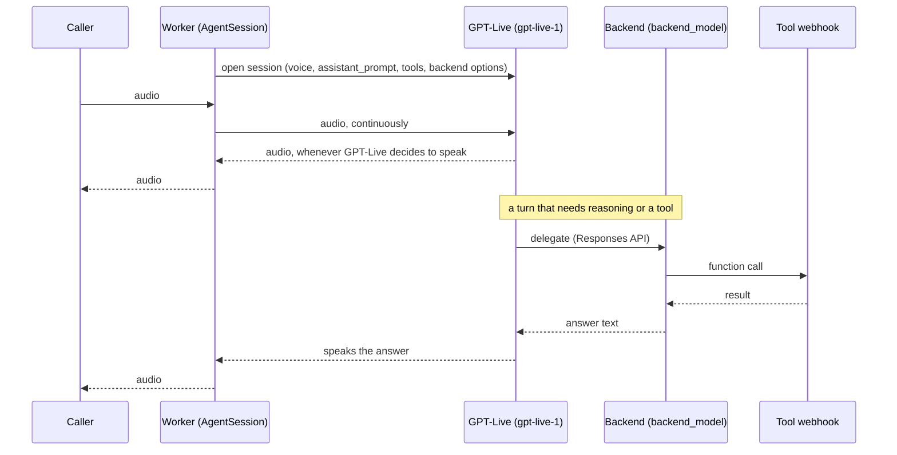

# Duplex Mode (GPT-Live)

`assistant_mode="duplex"` runs OpenAI **GPT-Live** (`gpt-live-1`), a full-duplex voice model. It
hears the caller and speaks at the same time, and it decides for itself when to talk, when to stop
and when to say "mm-hm". There is no turn detector to tune.

GPT-Live is a voice model, not a thinker. When a turn needs reasoning or a tool, it hands the work
to a second model, the **backend**: an ordinary OpenAI Responses model (`backend_model`, default
`gpt-5.6-luna`). The backend's answer comes back to GPT-Live, which says it in its own voice.

Added in 1.6.0. Field reference: [Models & Providers → GPT-Live](../reference/models.md#gpt-live-duplex-mode-only).
Rules and refusals: [Compatibility Matrix → Duplex mode](../reference/compatibility.md#duplex-mode).

## How it compares

| | `pipeline` | `realtime` | `cascade` | `duplex` |
|---|---|---|---|---|
| Who hears the caller | realtime model | realtime model | STT plugin | GPT-Live |
| Who thinks and runs tools | realtime model | realtime model | Responses LLM | **backend** Responses model |
| Who speaks | TTS plugin | realtime model | TTS plugin | GPT-Live |
| Who decides it is the agent's turn | server VAD | server VAD | local VAD + turn detector | **GPT-Live itself** |
| Can talk while the caller talks | no | no | no | **yes** |
| Can speak a fixed string (`say`) | yes | no | yes | no |

## What happens on a call

1. **The worker builds one model.** `create_gpt_live` (`src/core/agents/llm/factory.py`) creates
   `openai.realtime.GPTLiveModel` with `delegation="responses"`. The backend's model, its
   instructions (`backend_instructions`) and the generation knobs go in `responses_options`. Knobs
   the backend cannot read are dropped with a log line, the same way `create_llm` does in cascade.
2. **The session has no STT and no TTS.** `AgentSession(llm=..., vad=...)` gets a local Silero VAD
   (`inference.VAD(model="silero")`) passed explicitly. It is not used for turn-taking; it is what
   lets the worker cut the audio the caller hears when they barge in.
3. **Tools run on the backend.** The assistant's tools and the built-in `end_call` are sent with
   strict JSON schemas, as in cascade, because the backend speaks the Responses API.
4. **The greeting is a request, not a script.** With `speaks_first`, the start instruction goes to
   GPT-Live through `generate_reply`, and the model phrases the greeting itself. Silence re-prompts
   use the same path.

## What is fixed for the session

GPT-Live takes its voice, its voice persona (`assistant_prompt`) and the backend's instructions
once, when the session opens. None of them can change mid-call, so features that would swap a
prompt mid-call do nothing here.

## What duplex cannot do

`session.say()` needs a TTS, and duplex has none. So the API refuses, when the assistant is saved,
everything that depends on it:

- a prerecorded greeting (`assistant_greeting_audio` enabled),
- filler words,
- `text_only` web calls (GPT-Live has no text modality).

`temperature` is refused too: every allowed backend model is a reasoning model.

## Telephony

On an Exotel outbound call the caller's line plays a ring tone before they answer. GPT-Live would
treat that as speech and answer it, so the worker mutes the caller's input until the call is
answered, whatever `allow_interruptions` and `speaks_first` say (every mode does the same when the
assistant does not speak first). If the answer signal never arrives, the mute lifts after 60
seconds. The reply-start input guard, which
blanks the caller for a moment at the start of each reply in other modes, is off in duplex: GPT-Live
listens while it speaks, and blanking the input would deafen it.

## Validation

The same four gates as cascade, applied to both models:

1. **Schema.** `model` must be `gpt-live-1`, `voice` one of the six GPT-Live voices,
   `backend_model` a reasoning model, `backend_instructions` at most 4000 characters.
2. **Mode rules** (`validate_mode_config`). Provider `openai` only; the greeting, filler and
   `temperature` refusals above; knobs checked against `backend_model`.
3. **Served models.** `GET /v1/models` must list both `gpt-live-1` and the backend model.
4. **Request probe.** One short Responses call with the real backend, knobs and tool schemas, so a
   value the backend refuses is a `422` at save time, not a silent call.

Switching an assistant into or out of `duplex` clears the stored `assistant_llm_config` unless the
same request sends a new one: no model id is valid in both.

## Usage and cost

The usage record carries two entries:

- **GPT-Live** is billed per second of open session, $0.05 per minute. The seconds are in
  `llm_session_duration`.
- **The backend** is billed for its tokens at its own rate, as a separate `model_usage` entry.
  OpenAI reports it under a dated snapshot name (`gpt-5.6-luna-2026-04-23`); pricing looks up the
  alias's rate for it.

See [Pricing](../reference/pricing.md) for the rates.

## Deploying

Deploy the **agent image before the API**. An older worker does not know `duplex` and treats the
assistant as `pipeline`, which needs a TTS config a duplex assistant does not have: the job ends
and the caller hears nothing. Known behaviours that are not faults (no greeting, talking over a
barge-in) are in [Troubleshooting → Duplex mode](../reference/troubleshooting.md#duplex-mode).
