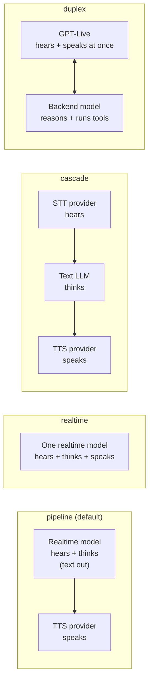

# Assistant modes

Every assistant runs in one of four **modes**, set by `assistant_mode`. The mode decides how many
models are in the loop and who does the listening, the thinking and the speaking. A second,
independent field, `assistant_llm_config.provider`, picks the LLM vendor.

Field reference: [Create assistant](../api/assistant/create.md). Which combinations are legal:
[Compatibility Matrix](../reference/compatibility.md). Model IDs and config keys:
[Models & Providers](../reference/models.md).

## The four modes

| | `pipeline` (default) | `realtime` | `cascade` | `duplex` |
|---|---|---|---|---|
| What runs | A realtime model emits **text**; an external TTS speaks it (a "half-cascade") | One model does STT, LLM and TTS and speaks its own **audio** | Three separate stages: STT provider, a plain (non-realtime) text LLM, TTS provider | OpenAI **GPT-Live** (`gpt-live-1`), a full-duplex voice model, plus a **backend** reasoning model that runs tools |
| LLM vendor | `openai` only (`gpt-realtime-1.5` by default) | `gemini` (default) or `openai` | `openai` only | `openai` only |
| TTS required | yes (`assistant_tts_model` + `assistant_tts_config`) | no; TTS fields are ignored | yes | no; TTS fields are ignored |
| STT | Side channel for transcripts only: a parallel Sarvam transcriber (default) or the model's own transcription | The model transcribes itself | `assistant_stt_model` is the first stage: `sarvam`, `cartesia`, `deepgram`, `elevenlabs` or `openai` | none; STT fields are ignored |
| Who decides it is the agent's turn | the realtime model's own voice-activity detection (VAD) | the realtime model's VAD | a local voice-activity detector plus an end-of-utterance model | GPT-Live itself |
| Greeting with `speaks_first=true` | generated from `assistant_start_instruction`, or a prerecorded greeting | generated, or a prerecorded greeting | generated, or a prerecorded greeting | GPT-Live phrases it itself and may decline; no prerecorded greeting |
| Depth | below | below | [Cascade](cascade.md) | [Duplex](duplex.md) |

The provider defaults to `gemini` in `realtime` mode and to `openai` in the other three.
**`gemini` is accepted in `realtime` mode only**; `pipeline`, `cascade` and `duplex` reject it with
a `422`.

| Mode | provider `openai` | provider `gemini` |
|---|---|---|
| `pipeline` | OpenAI realtime model (text out), then external TTS | rejected at create/update |
| `realtime` | OpenAI realtime model (audio out) | Gemini Live (STT + LLM + TTS) |
| `cascade` | STT provider, then OpenAI text LLM, then TTS provider | rejected at create/update |
| `duplex` | GPT-Live `gpt-live-1` + backend reasoning model | rejected at create/update |

**Why Gemini is not available in `pipeline` mode.** A half-cascade needs the realtime model to
answer in text only, so an external TTS can speak the result. Google's Live API supports that only
on models without native audio ([googleapis/python-genai#1780](https://github.com/googleapis/python-genai/issues/1780)),
and the Live models this platform runs are native-audio. Use `realtime` for Gemini.

### What every mode shares

- The same room handling, call lifecycle, transcripts and tool execution. See
  [Call lifecycle](call-lifecycle.md).
- Assistant-first openings: with `assistant_interaction_config.speaks_first=true`, the assistant
  opens the call using `assistant_start_instruction`.

## Transcripts

### Transcription of the caller in `pipeline` mode

In `pipeline` mode the realtime model listens to the caller directly, so transcription is a side
channel that only decides what lands in the stored transcript. It is chosen with
`assistant_stt_model` and configured with `assistant_stt_config`; unset means `sarvam`.

| `assistant_stt_model` | Effect in `pipeline` mode |
|---|---|
| `sarvam` (default) | Sarvam Saras v3 transcribes the caller in parallel and writes the user transcript. Config keys: `model` (default `saaras:v3`), `language` (default `unknown`, auto-detect), `mode` (default `codemix`), `api_key`. |
| `native` | The realtime model writes the user transcript itself. No config keys. |
| `openai` | Same as `native` (same vendor, same transcription model). |
| `cartesia`, `deepgram`, `elevenlabs` | **Cascade only.** In `pipeline` mode the selection is ignored and the realtime model transcribes itself. |

Sarvam is the default because it is trained on Indic and code-switched speech (Hindi, English,
Tamil and Urdu in one call) and writes each word in its own script. The realtime model's built-in
transcription tends to switch scripts mid-sentence, romanise words, and invent phrases on noisy
phone audio, and its transcription model cannot be replaced by a third-party one.

What to know about the Sarvam side channel:

- **It only fixes the stored transcript.** The realtime model still hears the raw audio. If the
  model *misunderstands* Indic speech, its replies show it. To fix understanding too, use
  [`cascade`](cascade.md) (where the Sarvam transcript is the only thing the LLM sees) or
  `realtime` with `gemini`.
- **Keys.** It authenticates with `assistant_stt_config.api_key`, falling back to the platform's
  Sarvam key. It never reads `assistant_tts_config.api_key`, which belongs to your TTS provider.
  If no Sarvam key is available, the call uses `native` transcription instead.
- **Fragments are joined.** One spoken sentence with pauses can come back from Sarvam in pieces.
  Pieces that arrive within 1 second of each other are joined into one transcript line; the line
  is also closed as soon as the assistant starts speaking. A pause longer than that splits the
  line. The same joining applies to `native` transcripts.
- **Order is speaking order.** Each transcript line is stamped when it was spoken (for a joined
  line, when its first piece arrived), and stored transcripts are kept sorted by that time, so a
  user line that took longer to transcribe still appears before the reply it caused.
- The retired keys `assistant_interaction_config.user_stt_provider` and `.stt_api_key` are
  rejected with `422`; use `assistant_stt_model` and `assistant_stt_config`.

### Native transcription

When the model transcribes the caller itself (`native` in `pipeline`, and always in `realtime`):

- On OpenAI it uses `gpt-4o-mini-transcribe`, with a prompt built from
  `assistant_interaction_config.preferred_languages` and rules for literal transcription: native
  script, no romanisation, no translation, `[inaudible]` instead of a guess. Phone calls use
  far-field noise reduction; web calls use near-field.
- The language is never pinned, so a caller who switches language mid-call is still transcribed.
  `preferred_languages` is a hint, not a constraint.
- OpenAI bills this transcription separately from the realtime model; the usage record reports
  it with `stt_provider="openai"` and token counts. See [Usage accounting](../reference/usage-accounting.md).
- On Gemini none of the prompt applies (Gemini transcribes on its own defaults), and no separate
  STT usage is reported: the input audio is already inside the LLM prompt tokens.

### What reaches the transcript

Hold and the "waiting for the callee to answer" state keep the **assistant** quiet and out of the
transcript. They never suppress the caller: anything the caller says is stored, which can include
speech while on hold or ring-tone audio before answer if the model transcribes it.

### The caller's last words before hangup

When the caller hangs up, any assistant speech still playing is cut off, and the stored assistant
line is the part actually spoken. The platform then waits up to **4 seconds** for the caller's
last utterance to be transcribed before closing the transcript, so the usage record and the
end-of-call webhook arrive up to 4 seconds later.

| Transcription | Last utterance recovered? |
|---|---|
| Sarvam (`pipeline`) | Yes |
| `native`, OpenAI | Yes; the assistant does not reply to it |
| `native`, Gemini | **No.** Gemini only finalises a transcript at the end of a turn, which a mid-turn hangup never reaches. This is a Gemini API limitation. |
| `cascade` | Yes, and the call closes as soon as the last words land instead of always waiting 4 s |
| text-only chat | Nothing to recover |

## How to choose

| You want | Mode |
|---|---|
| Lowest latency, one vendor, no cost breakdown needed | `realtime` |
| Realtime understanding with a specific TTS voice | `pipeline` |
| Cost per component, cheap text models, a swappable STT provider | [`cascade`](cascade.md) |
| The most natural turn-taking: overlapping speech, backchannels ("mm-hm" while you talk), nothing to tune | [`duplex`](duplex.md) |

`duplex` trades control for naturalness. GPT-Live decides when to speak and when to stop, so it
cannot play a prerecorded greeting, speak filler words, run text-only, or take a new prompt in the
middle of a call. Its voice persona (`assistant_prompt`) and backend instructions
(`backend_instructions`) are fixed for the whole session. A barge-in (the caller talking over the assistant) stops the audio the caller
hears, but the model can still finish its sentence. See [Duplex](duplex.md) and
[Compatibility Matrix → Duplex mode](../reference/compatibility.md#duplex-mode).

## Latency and cost reduction

Two techniques apply automatically to OpenAI realtime models (`pipeline` and `realtime` with
`openai`). Nothing needs to be configured.

### LLM context truncation

The OpenAI Realtime API keeps the whole conversation in its server-side session, with no cap by
default. A 2-minute call can grow past 55,000 tokens, which raises both the cost (billed per
token) and the time to first response (the model reads the longer context every turn).

The platform caps it on every OpenAI realtime session:

- **8,000 tokens** of context after the system prompt (`post_instructions`).
- When the cap is hit, the **most recent 75%** of the conversation is kept and the oldest 25% is
  dropped (`retention_ratio=0.75`).

Observed: a 2-minute call went from about 55,000 tokens to about 7,300, an 87% reduction.

Applies to the `gpt-realtime*` models. Older realtime models that predate the truncation field
(`gpt-4o-realtime-preview`, `gpt-4o-mini-realtime-preview`) are no longer accepted; a stored
assistant that still holds one runs without the cap. Gemini and the `cascade` and `duplex` modes
do not use it.

### Sarvam TTS connection kept warm

Sarvam closes an idle TTS connection after about 5 seconds. Reconnecting before every reply would
add 300–800 ms before the first audio. On assistants whose TTS is Sarvam, the platform keeps the
connection alive for the whole call, so the reconnect happens once at call start instead of
between turns. This applies to `pipeline` and `cascade`.
