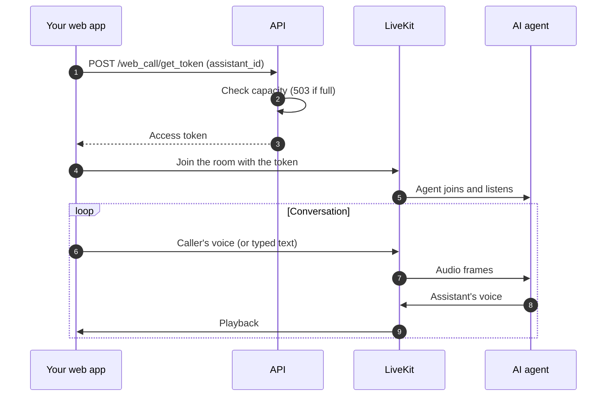
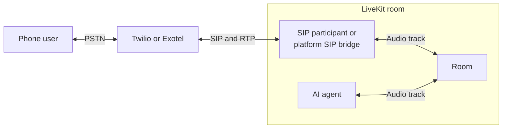
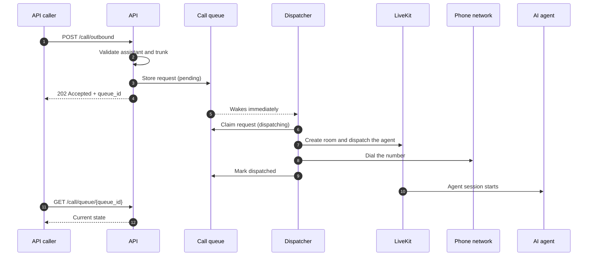
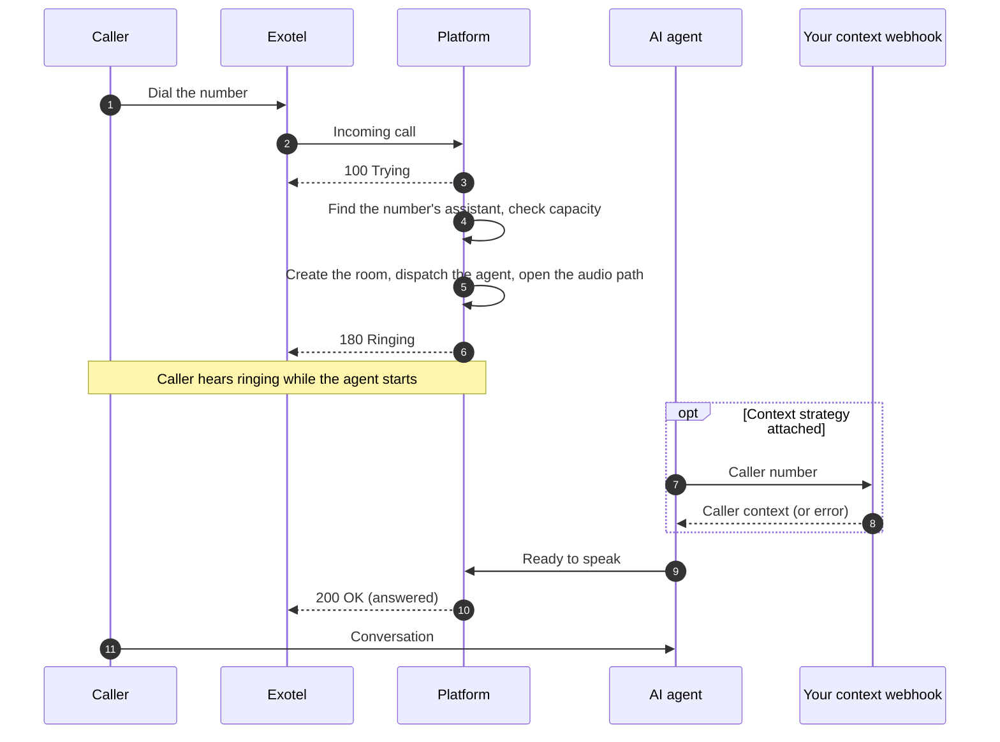
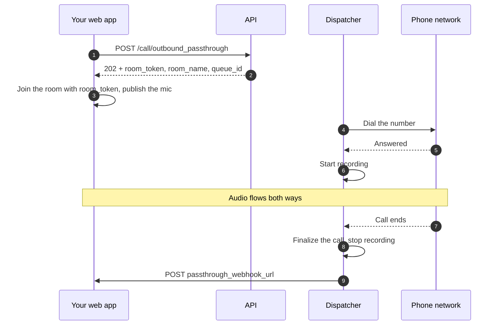

# Call lifecycle

What happens from the moment a call is requested until it ends: web calls, phone calls in both
directions, the outbound queue, capacity limits, hold, and passthrough calls that have no AI
agent at all. For the shapes an assistant can take once a call is connected, see
[Assistant modes](assistant-modes.md).

## Kinds of call

| Call | How it starts | What carries the audio |
|---|---|---|
| Web call | [`POST /web_call/get_token`](../api/calls/web-call.md) returns a token; the browser joins with it | The browser's microphone and speaker, over LiveKit |
| Outbound phone call | [`POST /call/outbound`](../api/calls/trigger.md) queues the call; the platform dials it | A phone line through a SIP trunk (Twilio or Exotel) |
| Inbound phone call | Someone dials a number [mapped to an assistant](../api/inbound/index.md) | An Exotel phone line |
| Passthrough call | [`POST /call/outbound_passthrough`](../api/calls/passthrough.md) | A web user's microphone bridged straight to a phone, with no AI agent |
| Meeting call | The assistant joins an online meeting | See [Meeting calls](meeting-calls.md) |

Every call is recorded as a call record that you can read through
[`GET /call/records`](../api/calls/tracking.md).

## Web calls

The token request reserves a slot for the call. If the platform is at its web-call limit, the
request fails with `503 Server at capacity, please retry shortly` and no call record is created.
A web call can also be text-only (`text_only: true`), which turns off the microphone and speech
entirely; realtime and duplex assistants cannot run text-only. Details:
[Web call](../api/calls/web-call.md).

## Phone calls: two provider paths

| | Twilio | Exotel |
|---|---|---|
| Directions | Outbound only | Outbound and inbound |
| How it connects | A standard LiveKit SIP participant joins the call's room | The platform runs its own SIP and media bridge to Exotel |
| Hold detection | No | Yes, on outbound calls (see [Hold and resume](#hold-and-resume)) |

Inbound Twilio calls are not supported. A trunk's type must match the `call_service` of the
call request, or the request is rejected with `400`.

Phone audio is narrow-band (8 kHz). The platform cleans it up before the assistant hears it and
tells OpenAI's transcription that the audio comes from a phone line, which reduces invented words
on noisy lines. Web calls get settings tuned for a close microphone instead.

## Outbound calls and the queue

An outbound request is never dialled inline. It is stored in a queue and answered at once with
`202 Accepted` and a `queue_id`; a dispatcher dials it as soon as there is capacity.

### Queue states

Read the state with [`GET /call/queue/{queue_id}`](../api/calls/queue-status.md).

| State | Meaning |
|---|---|
| `pending` | Waiting for a free slot |
| `dispatching` | A slot is reserved and the room and dial are being set up |
| `dispatched` | The room exists and the phone call has been started |
| `failed` | Every attempt failed; `last_error` holds the reason |

- **Retries.** A dispatch that fails (inactive trunk, SIP error, LiveKit error) goes back to
  `pending` and is tried again on the next pass. After 3 attempts the request becomes `failed`.
- **Speed.** The dispatcher wakes the moment a request is queued and the moment any call ends, so
  a waiting request is dialled as soon as a slot frees up. It also rechecks the queue every 30
  seconds as a safety net.
- **Stuck requests.** A request left in `dispatching` for more than 5 minutes (for example
  because a dispatcher crashed) is put back to `pending`, and counts as one failed attempt.
- **Restarts.** Requests still `pending` when the platform restarts are dialled after it comes
  back. Calls already in progress are not cut by a dispatcher restart.

`dispatched` means the dial started, not that anyone answered. Follow the call itself through its
call record and the [end-of-call webhook](../api/calls/webhook.md).

### What the callee hears, and when the assistant speaks

On an Exotel call the assistant does not speak into the ring tone. It waits for the answer (up to
60 seconds), confirms recording has started (up to 12 seconds), adds a short pause so the audio
path settles, and only then greets. If the callee hangs up during that wait, the greeting is
skipped. Until the call is answered, the caller's side is muted so the ring tone is not mistaken
for speech. Full sequence: [Call flow](../api/calls/flow.md).

### Outcomes that end an outbound call early

| Situation | Result on the call record |
|---|---|
| The SIP setup gets no final answer within 60 seconds (Exotel) | Status `timeout` |
| The callee is busy, rejects, or does not answer | The matching status (`busy`, `rejected`, `no_answer`, ...) |
| The phone answered but no audio ever arrived for 60 seconds (Exotel) | Status `failed` |
| The phone answered but the agent never joined within 15 seconds | The call is ended instead of sitting in silence |

An end-of-call webhook is sent for these outcomes too.

## Inbound calls (Exotel)

Each inbound number is mapped to an assistant through [`/inbound`](../api/inbound/manage.md), and
can optionally carry an [inbound context strategy](../api/inbound-context-strategy/index.md): a
webhook the platform calls with the caller's number so the assistant knows who is calling before
it speaks.

The call is answered only when the agent is ready, so the caller hears ringing instead of dead
air while the agent starts and the context webhook answers. If the agent is not ready after about
15 seconds of ringing, the call is answered anyway: a slow agent delays the answer, it never
drops the call. A caller who hangs up while it is ringing simply ends the call.

### When an inbound call is refused

| What the caller's network receives | Why |
|---|---|
| `480 Temporarily Unavailable` | No active mapping for the dialled number, or the mapped assistant is missing or inactive |
| `486 Busy Here` | The platform is at its phone-call limit, or has no free media port |
| `487 Request Terminated` | The caller hung up before the call was answered |
| `500 Internal Server Error` | The room, call record or agent dispatch could not be created |
| `503 Service Unavailable` | The platform's phone integration is misconfigured, or the audio path could not be set up |
| `400 Bad Request` | The call offer was malformed or duplicated an existing call |

A missing or failing context strategy never fails the call. If the webhook times out, errors or
returns an invalid payload, the assistant starts with its normal prompt.

## Capacity limits

The platform limits how many calls run at once, separately for each kind of call, plus one
overall limit across all of them. On a default deployment:

| Pool | Default limit | Counts |
|---|---|---|
| Phone calls | 12 | Inbound, outbound and passthrough calls |
| Web calls | 40 | Web calls, including text-only |
| Meeting calls | 4 | Meeting calls |
| Everything | 48 | All calls together |

A call needs room in its own pool **and** in the overall limit. Separate pools mean a burst of web
sessions cannot give phone callers a busy tone. What you see at the limit depends on the kind of
call:

| Call | At the limit |
|---|---|
| Outbound phone call | Stays `pending` in the queue and is dialled when a slot frees up |
| Web call | `503` from the token request; retry later |
| Meeting call | `503`; retry later |
| Inbound phone call | The caller hears busy (`486 Busy Here`) |

Self-hosted deployments can change these limits. Calls that are still ringing count against the
limit, as do calls in progress.

## Hold and resume

When the person on an outbound Exotel call puts it on hold, the assistant goes quiet until the
call resumes:

- any reply in progress is cut off, and new replies are stopped;
- silence reprompts and filler words pause;
- the assistant's lines during hold are not saved to the transcript, but anything the caller says
  is still saved.

On resume, silence reprompts restart and the conversation continues normally. Hold is detected
instantly from the phone network's own hold signal. Twilio calls, and inbound Exotel calls, have
no hold detection, so an assistant on a long hold may respond to hold music.

## Background noise and interruptions

On every call with audio, the caller's audio passes through a speech filter before the assistant
hears it. Steady background noise, keyboard typing and similar sounds are removed, so they cannot
interrupt the assistant mid-sentence. The filter cannot tell the caller apart from other human
voices: a television or a second person talking nearby still counts as speech.

The filter does not stop short repeated words ("Hello? Hello?") or filler sounds ("um", "uh")
from interrupting, because those are real speech. For that, the assistant ignores the caller for
the first few seconds of every reply:

| Field | Default | Range | Effect |
|---|---|---|---|
| `assistant_interaction_config.input_guard_window_sec` | `3.0` | `0`–`10` | Seconds at the start of each reply during which the caller cannot interrupt. Higher rejects more filler sounds; the caller also cannot genuinely interrupt during it. `0` turns it off. |

If the assistant finishes its reply before the window ends, the caller can speak again
immediately. The window does not apply to duplex assistants (they listen while they speak) or to
text-only chats. Set it with [`/assistant/create`](../api/assistant/create.md) or
[`/assistant/update`](../api/assistant/update.md).

## How a phone call ends

A phone call ends when either side hangs up or when the room closes. On Exotel calls it also ends
when the audio stops: no audio from the phone for 30 seconds after it had been flowing is treated
as a hang-up, and no audio at all for 60 seconds after the answer ends the call as failed. The
call record is then finalized once, with its final status, duration and billable duration, and
the end-of-call webhook is sent. See [Webhook](../api/calls/webhook.md).

## Passthrough calls

A passthrough call connects a human web user directly to a phone number. It uses the same queue
and phone paths as an AI call, but no AI agent joins: no speech recognition, no LLM, no voice.

| Aspect | AI call | Passthrough call |
|---|---|---|
| Who talks to the phone | The AI agent | Your web user |
| Room | Created when the call is dialled | Created by the request, so the token is ready at once |
| Token in the response | No | Yes, `room_token` |
| Trunk | Any active trunk | A trunk with `passthrough_mode` enabled |
| Recording starts | Started by the agent session | Exotel: when the phone answers. Twilio: as soon as the dial starts |
| Transcript | Full transcript | Always empty |
| End-of-call webhook | The assistant's `assistant_end_call_url` | The trunk's `passthrough_webhook_url`, also for busy, no-answer and timeout outcomes |
| Finding the calls | All call listings and analytics | `GET /call/records?passthrough_only=true`; they belong to no assistant |

On Exotel, the web user hears the phone's ringing and busy tones before the call is answered. Details:
[Passthrough](../api/calls/passthrough.md).

## Provider support

| Provider | Inbound | Outbound | Passthrough | Hold detection |
|---|---|---|---|---|
| `exotel` | Supported | Supported | Supported | Outbound calls |
| `twilio` | Not supported | Supported | Supported | No |
