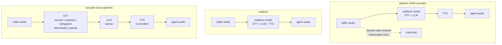

# Cascade mode (STT → LLM → TTS)

`assistant_mode="cascade"` runs a **true three-stage pipeline**: a speech-to-text (STT) provider,
a plain (non-realtime) text LLM, and a text-to-speech (TTS) provider. Each stage is a separate
model, separately metered and independently swappable.

Pick it when you need cost per component, cheap text models, or a specific STT provider. The
other modes are compared in [Assistant modes](assistant-modes.md). Model IDs and config keys:
[Models & Providers](../reference/models.md).

## Why it exists

`pipeline` mode is a *half*-cascade: one realtime model does STT **and** LLM as a single billing
unit, and only TTS is separate. That has three consequences:

1. **No cost breakdown.** A realtime model bills one audio-token stream, so you cannot tell what
   transcription cost versus reasoning.
2. **No cheap models.** The LLM must be a realtime model; `gpt-4.1-mini` is out of reach.
3. **Transcription is a side channel.** The Sarvam transcriber runs beside the model rather than
   feeding it.

Cascade fixes all three by giving the call a real STT stage.



## Configuration

```json
{
  "assistant_name": "Cascade Agent",
  "assistant_description": "True STT -> LLM -> TTS pipeline",
  "assistant_prompt": "You are a helpful assistant.",
  "assistant_mode": "cascade",
  "assistant_stt_model": "sarvam",
  "assistant_stt_config": {
    "model": "saaras:v3",
    "language": "unknown",
    "mode": "codemix"
  },
  "assistant_llm_config": {
    "provider": "openai",
    "model": "gpt-4.1-mini"
  },
  "assistant_tts_model": "cartesia",
  "assistant_tts_config": {
    "voice_id": "a167e0f3-df7e-4277-976b-be2f952fa275"
  }
}
```

Validation rules specific to cascade:

| Rule | Why |
|---|---|
| `assistant_tts_model` + `assistant_tts_config` required | The LLM emits text only; something must speak it. |
| `assistant_stt_model` must be `sarvam`, `cartesia`, `deepgram`, `elevenlabs` or `openai` | `native` means "the realtime model transcribes itself", and cascade has no realtime model. |
| `assistant_llm_config.provider` must be `openai` or unset | Only OpenAI is available as a non-realtime LLM. |
| `assistant_llm_config.model` must be a documented OpenAI ID | A curated allowlist of tested models; an unknown name is a `422` listing the supported IDs. See [Models & Providers](../reference/models.md#cascade-llm-cascade-mode-only). |

These rules are checked again against the **stored** assistant on update, not only against the
request. Switching an existing assistant into cascade while it still holds `provider: "gemini"` or
a realtime `model` returns `400`, so send the corrected `assistant_llm_config` in the same PATCH.
Every mode's rules, and what happens when one is broken, are in the
[Compatibility Matrix](../reference/compatibility.md).

## STT stage

All five providers stream (only `openai` can be switched to batch; see `use_realtime` below).

**API keys.** Every STT provider accepts an `api_key` in `assistant_stt_config`; a per-assistant
key always wins over the platform's key for that provider. Sarvam and ElevenLabs each use one key
for both STT and TTS, and the `openai` STT shares its platform key with the cascade LLM. If
neither a per-assistant key nor a platform key exists, the assistant is **refused at
create/update** (`422`/`400`), because the stage could not authenticate and the call would connect
to silence. If such an assistant still reaches a call, the call never starts: the caller hears nothing and the worker logs one error; the platform
never silently swaps providers.

In `pipeline` mode the cascade-only providers do nothing: see
[Assistant modes](assistant-modes.md#transcription-of-the-caller-in-pipeline-mode).

**Pitfalls.** Deepgram's `enable_diarization` works on the nova models only, and
`flux-general-en` is English-only. Setting an ElevenLabs `language_code` turns auto-detect off.
Omitted `language` on Deepgram falls back to `en-US` on models that cannot detect, whereas omitted
`language_code` on ElevenLabs auto-detects. Full list:
[STT pitfalls & what not to combine](../reference/models.md#stt-pitfalls-what-not-to-combine).

### sarvam: the multilingual default

| Config key | Default | Values |
|---|---|---|
| `model` | `saaras:v3` | see [Models & Providers](../reference/models.md#stt) |
| `language` | `unknown` | `unknown` = **auto-detect**, or a fixed BCP-47 code |
| `mode` | `codemix` | see [Models & Providers](../reference/models.md#stt) |
| `api_key` | platform Sarvam key | per-assistant override |

**The strongest choice for code-switched speech.** `language="unknown"` auto-detects, and
`mode="codemix"` keeps code-switching intact *inside one utterance*: a Hindi sentence with English
nouns is transcribed in both scripts correctly. The 24 `-IN` language codes are listed in
[Models & Providers](../reference/models.md#stt).

Other modes: `transcribe` gives a plain transcript, `translate` returns English, `verbatim` keeps
filler words and repetitions, `translit` romanises Indic script.

### cartesia: one fixed language

| Config key | Default | Values |
|---|---|---|
| `model` | `ink-whisper` | see [Models & Providers](../reference/models.md#stt) |
| `language` | `en` | one fixed code; **no auto-detect** |
| `api_key` | platform Cartesia key | per-assistant override |

Cartesia STT cannot detect the language: you pick one code and it transcribes that. Use Sarvam
for any call where the caller might switch languages. `ink-whisper` covers 43 languages; the list
is in [Models & Providers](../reference/models.md#stt).

### deepgram: multilingual with `nova-3`

| Config key | Default | Values |
|---|---|---|
| `model` | `nova-3` | `nova-3` (multilingual, 45 languages), `nova-3-general`, `nova-3-multilingual`, `flux-general-en` (English), `flux-general-multi` |
| `language` | `multi` on `nova-3` / `flux-general-multi`, else `en-US` | a fixed BCP-47 code (`en-US`, `hi-IN`), or `multi` to **auto-detect** per segment. A 3-letter code such as `hin` belongs to ElevenLabs and is rejected. On the flux models this is only a hint, and only `flux-general-multi` reads it |
| `enable_diarization` | `false` | label each utterance with its speaker (nova models only); never turned on unless you set it |
| `keyterm` | not sent | a string or list of terms to bias recognition toward |
| `api_key` | platform Deepgram key | per-assistant override |

`nova-3` with `language="multi"` covers 45 languages and auto-detects, so a caller who switches
language mid-call is still transcribed without pinning a code. `multi` bills at a higher
per-minute rate: pin a code to avoid it.

### elevenlabs: auto-detecting `scribe_v2_realtime`

| Config key | Default | Values |
|---|---|---|
| `model` | `scribe_v2_realtime` | `scribe_v2_realtime` (auto-detects about 190 languages), `scribe_v2`, `scribe_v1` |
| `language_code` | omitted: auto-detect | an **ISO 639-3** code (`eng`, `hin`, `ben`), **not** BCP-47 and **not** ISO 639-1. Any other code would make ElevenLabs close the connection, so an unrecognised code is dropped and the call auto-detects. A valid code **turns auto-detect off** |
| `no_verbatim` | `false` | `true` strips filler words ("um", "uh") from the transcript |
| `api_key` | platform ElevenLabs key | per-assistant override; the same key serves ElevenLabs TTS |

### openai: one vendor for STT and LLM

| Config key | Default | Values |
|---|---|---|
| `model` | `gpt-4o-mini-transcribe` | `gpt-4o-mini-transcribe` (fast, cheap), `gpt-4o-transcribe` (more accurate, dearer), `whisper-1` (legacy batch model, the only one that reads `prompt`). `gpt-realtime-whisper` is **rejected** |
| `language` | omitted: auto-detect | one ISO 639-1 code (`en`, `hi`), **not** BCP-47 (`hi-IN` is rejected). Ignored when `detect_language` is `true` |
| `detect_language` | `false`, or `true` when no valid `language` is set | `true` auto-detects and overrides `language` |
| `prompt` | not sent | text biasing spellings and jargon; **`whisper-1` only** (the gpt-4o models accept and ignore it) |
| `noise_reduction_type` | not sent | `near_field` (headset) or `far_field` (speakerphone / room mic) |
| `use_realtime` | `true` | `true` streams (interim results, low latency); `false` uses batch transcription, which adds a full utterance of latency per turn and is **accepted only for `whisper-1`** |
| `api_key` | platform OpenAI key | per-assistant override; the same key the cascade LLM uses |

Pick this when the assistant already uses OpenAI for the LLM and you want one vendor, one key and
one invoice for both stages. It is *not* the multilingual choice: it pins one language unless
`detect_language` is on, and even then Sarvam handles Indic code-switching better.

Why `use_realtime: false` is `whisper-1` only: batch transcription reports no token usage, and the
other OpenAI STT models are billed per token, so the call would store zero STT spend. `whisper-1`
is billed by audio duration, which the platform measures itself. An assistant stored with the
unsafe pairing before this rule existed is streamed anyway. `gpt-realtime-whisper` is rejected
because it needs a client-side voice detector this platform does not provide.

Minimal, English, everything defaulted:

```json
{
  "assistant_stt_model": "openai",
  "assistant_stt_config": {}
}
```

Auto-detecting, on a speakerphone-heavy inbound line:

```json
{
  "assistant_stt_model": "openai",
  "assistant_stt_config": {
    "model": "gpt-4o-transcribe",
    "detect_language": true,
    "noise_reduction_type": "far_field"
  }
}
```

Prompt-biased for domain jargon (needs `whisper-1`, and therefore batch is allowed):

```json
{
  "assistant_stt_model": "openai",
  "assistant_stt_config": {
    "model": "whisper-1",
    "language": "en",
    "prompt": "Vyom, LiveKit, Exotel, SIP trunk, Sarvam",
    "use_realtime": false
  }
}
```

## LLM stage

The cascade LLM is an OpenAI model called through the Responses API (cheaper than chat
completions, and tools work the same way).

| Config key | Default | Notes |
|---|---|---|
| `provider` | `openai` | Only `openai` is supported in cascade |
| `model` | `gpt-4.1` | Must be one of the documented OpenAI models. List in [Models & Providers](../reference/models.md#cascade-llm-cascade-mode-only) |
| `api_key` | platform OpenAI key | per-assistant override |
| `temperature` | provider default (`0.8`) | `0`–`2`. **Chat models only**; reasoning models reject it |
| `max_output_tokens` | model default | cap on output tokens, at least `16` |
| `reasoning_effort` | unset | `none`/`minimal`/`low`/`medium`/`high`/`xhigh`/`max`. **Reasoning models only**, and not on `gpt-5.2`/`gpt-5.4*` while tools are attached |
| `service_tier` | unset | `auto`/`default`/`fast`/`priority` on any model; `flex` on the gpt-5 line only. `scale` is not an OpenAI tier; see [measured](../reference/compatibility.md#service_tier-measured) |
| `verbosity` | unset | `low`/`medium`/`high`. **gpt-5 generation only** |
| `tool_choice` | unset | `auto`/`required`/`none` |
| `parallel_tool_calls` | unset | allow several tool calls in one response |

`temperature` and `top_p` are mutually exclusive on the Responses API; only `temperature` is
exposed. Omitting a knob keeps the provider's default.

Passing the allowlist is necessary, not sufficient. On create and update the platform also asks
OpenAI whether the account still serves the model, and whether it accepts this exact request
(model, knobs and tool schemas), with one short probe whose refusal becomes the `422`. See
[Compatibility Matrix → Cascade LLM knobs](../reference/compatibility.md#cascade-llm-knobs).

### Model-gated knobs

`temperature`, `reasoning_effort` and `verbosity` are not "ignored where irrelevant". OpenAI
answers a knob the model cannot read with an error on **every** turn: the call connects, nobody is
greeted, and the assistant never speaks. So the pairing is checked twice:

- **At create/update**, an impossible pairing is a `422` and is never stored.
- **At call time**, a knob the current model cannot read is dropped. This covers a stored config
  that outlived its model: set `reasoning_effort` on `gpt-5`, later switch to `gpt-4.1`, and the
  effort is still stored, but is not sent.

Which model reads which knob is listed per model, never guessed from the name:

- A chat model inside the gpt-5 generation reads `verbosity` and `temperature` but not
  `reasoning_effort`. The `gpt-5.x-chat-latest` aliases were such models (retired by OpenAI on
  2026-06-19 and no longer accepted), and OpenAI can ship another at any time.
- `gpt-6-luna` and `gpt-6-sol` behave like the `gpt-5.6` line (measured 2026-10-17): effort
  `none`/`low`/`medium`/`high`/`xhigh` with or without tools, `verbosity` and `flex` accepted;
  `temperature` and effort `minimal` refused.
- `gpt-5.2` and `gpt-5.4*` reject any reasoning effort once tools are attached (the built-in
  `end_call` tool counts). The platform makes sure none is sent in that case, even when you set
  none yourself.

## TTS stage

The same four providers as `pipeline` mode, configured the same way. Per-provider config:
[Create assistant](../api/assistant/create.md); model IDs and synthesis parameters:
[Models & Providers](../reference/models.md#tts).

## Turn detection

Cascade has no realtime model, so there is no server-side voice detector to rely on. The platform
runs its own, entirely on its own servers, with no extra key and no extra network call:

- **Voice activity detection (VAD)** decides when the caller is speaking. It waits for **0.4 s**
  of silence before treating speech as paused.
- **An end-of-utterance model** listens to the audio and judges whether the caller has finished
  their thought or is only pausing. It supports 14 languages, including Hindi.
- **Endpointing** is dynamic: the assistant waits between **0.3 s and 1.0 s** after the caller
  stops before replying, depending on how finished the utterance sounds.
- **Interruptions** are detected by voice activity: the caller must speak for at least **0.5 s**
  to interrupt. If an interruption turns out to be noise (no words within **2 s**), the assistant
  resumes what it was saying.

Unlike `pipeline` mode, where the realtime model's own detector interrupts the assistant on any
speech, these settings take effect in cascade, including `allow_interruptions=false` on the
greeting. Noise filtering runs its own voice detector before this one, so a cascade call runs two
detectors and uses a little more server CPU than the other modes. VAD and turn-detection model details:
[Models & Providers](../reference/models.md).

## Per-component usage

This is the reason the mode exists. The usage record reports one entry per provider and model,
folded into these fields:

| Field | Filled in |
|---|---|
| `llm_model`, `llm_input_*`, `llm_output_*`, `llm_total_tokens` | all modes |
| `llm_input_cached_*`, `llm_input_cache_creation_tokens` | all modes, whenever the provider reports a cache hit |
| `tts_characters_count`, `tts_audio_duration` | `pipeline`, `cascade` |
| `tts_input_tokens`, `tts_output_tokens` | token-billed TTS only |
| `stt_provider`, `stt_model`, `stt_audio_duration` | `cascade`, plus `pipeline` when the Sarvam transcriber runs. Sarvam audio is measured by the platform in both modes; the other cascade providers report their own. See [Usage accounting](../reference/usage-accounting.md) |
| `stt_input_tokens`, `stt_output_tokens` | token-billed STT: `openai` in `cascade`, and OpenAI's built-in transcription in `pipeline` / `realtime` |
| `stt_input_audio_tokens`, `stt_input_text_tokens` | parts of `stt_input_tokens`, reported by OpenAI's built-in realtime transcription only |
| `model_usage`, `usage_schema_version`, `sdk_version` | all modes |
| `usage_finalized` | all modes; `true` only on the final write at call end. See [Usage accounting](../reference/usage-accounting.md#when-the-record-is-written) |

Only a Gemini `realtime` call leaves the STT fields empty, and nothing is missing: its input audio
is already inside the LLM prompt tokens. `model_usage` is the raw per-provider-and-model list and
is what pricing should read; the flat fields add up across a mid-call model change.

These are raw usage metrics, not costs. They reach you through the
[end-of-call webhook](../api/calls/webhook.md), the [per-call usage endpoint](../api/calls/usage.md),
and the analytics endpoints ([user summary](../api/analytics/tokens-summary.md),
[user by model](../api/analytics/tokens-by-model.md), [admin summary](../api/admin/token-summary.md),
[admin by model](../api/admin/tokens-by-model.md), [by user](../api/admin/tokens-by-user.md),
[by assistant](../api/admin/tokens-by-assistant.md)). Rates: [Pricing](../reference/pricing.md).

## Text-only cascade

`cascade` with `text_only: true` on a [web call](../api/calls/web-call.md) is a pure text chatbot
on a plain chat model: no STT, no TTS and no voice detection are started. It is cheaper than the
same chatbot on a realtime model. `realtime` mode rejects `text_only`.

## Feature compatibility

Every runtime feature works in cascade:

| Feature | Cascade behaviour |
|---|---|
| Prerecorded greeting audio | Same as other modes |
| Speaks-first / `assistant_start_instruction` | Same as `pipeline`: the LLM generates the opening |
| `allow_interruptions=false` on the greeting | **Better than `pipeline`.** It is honoured here; in `pipeline` the realtime model's detector interrupts regardless |
| Noise filtering / noise cancellation | Same as other modes |
| Input guard (caller muted briefly as each reply starts) | Same as other modes |
| Silence re-prompts | Same; the re-prompt is a fixed spoken line |
| Filler words | Enabled, same as `pipeline` (needs an external TTS, which cascade has) |
| Hold / background sound / thinking sound | Same. The thinking sound is *more* noticeable, since a text LLM takes longer to its first word than a realtime model |
| Recording, waiting for the callee to answer | Same as other modes |
| Maximum call duration | Same |
| Function tools | Same contract |
| Transcripts | Written exactly once; the Sarvam side channel is off, so there is no double write |
| Sarvam TTS connection kept warm | Whenever the TTS is Sarvam, same as `pipeline` |
| **`end_call` tool** | The goodbye is spoken first and the call ends right after it, with no extra wait |
| **Before an outbound phone call is answered** | Ring-tone audio must not open a turn. While the assistant waits to greet, the caller's input is muted until the call is answered (unless `allow_interruptions` is on). When the assistant does not speak first, every mode mutes the input until answer, for at most 60 s |
| **`preferred_languages`** | **Not used by any cascade STT.** It is a hint for the realtime model's own transcription, which cascade does not have. Pin a language in `assistant_stt_config` instead |

Transcription quality in cascade is the STT provider's own; the realtime model's transcription
prompt and noise-reduction setting do not apply. `text_only: true` starts no STT, TTS or voice
detection at all.

## What cascade does not use

- **The Sarvam side-channel transcriber.** The STT is a real stage, so transcripts come from it
  directly. The side channel remains for `pipeline` mode.
- **Turn detection by a realtime model.** There is none in the loop.
- **The realtime model's transcription settings** (transcription model and prompt, noise
  reduction). They are Realtime API parameters.
