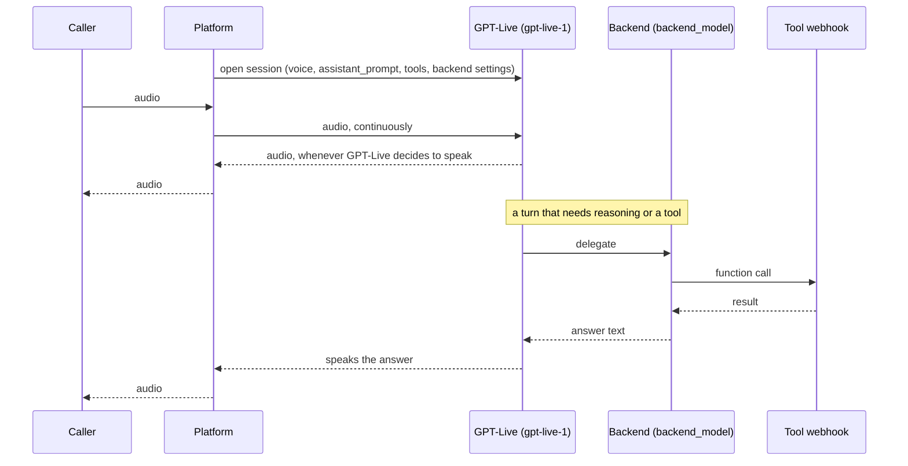

# Duplex mode (GPT-Live)

`assistant_mode="duplex"` runs OpenAI **GPT-Live** (`gpt-live-1`), a full-duplex voice model. It
hears the caller and speaks at the same time, and it decides for itself when to talk, when to stop
and when to say "mm-hm". There is no turn detection to tune.

GPT-Live is a voice model, not a thinker. When a turn needs reasoning or a tool, it hands the work
to a second model, the **backend**: an ordinary OpenAI model (`backend_model`, default
`gpt-5.6-luna`). The backend's answer comes back to GPT-Live, which says it in its own voice.

Field reference: [Models & Providers → GPT-Live](../reference/models.md#gpt-live-duplex-mode-only).
Rules and refusals: [Compatibility Matrix → Duplex mode](../reference/compatibility.md#duplex-mode).
The other modes: [Assistant modes](assistant-modes.md).

## How it compares

| | `pipeline` | `realtime` | `cascade` | `duplex` |
|---|---|---|---|---|
| Who hears the caller | realtime model | realtime model | STT provider | GPT-Live |
| Who thinks and runs tools | realtime model | realtime model | text LLM | **backend** model |
| Who speaks | TTS provider | realtime model | TTS provider | GPT-Live |
| Who decides it is the agent's turn | the model's own voice-activity detection (VAD) | the model's VAD | local VAD + end-of-utterance model | **GPT-Live itself** |
| Can talk while the caller talks | no | no | no | **yes** |
| Can speak a fixed sentence word for word | yes | no | yes | no |

## What happens on a call

1. **One voice model, one backend.** GPT-Live gets the voice and the voice persona
   (`assistant_prompt`). The backend gets `backend_instructions` and the generation knobs
   (`reasoning_effort`, `verbosity`, `service_tier`, `tool_choice`, `parallel_tool_calls`,
   `max_output_tokens`). A stored knob the backend cannot read is dropped for the call, the same
   way [cascade](cascade.md#model-gated-knobs) does it.
2. **No STT and no TTS.** A voice-activity detector still runs, but not to take turns: it lets the
   platform cut the audio the caller hears when they barge in.
3. **Tools run on the backend.** Your tools and the built-in `end_call` go to the backend model,
   with the same strict schema rules as cascade.
4. **The greeting is a request, not a script.** With `speaks_first`, `assistant_start_instruction`
   is passed to GPT-Live, which phrases the greeting itself and may decline. If it declines, the
   caller can still speak first. Silence re-prompts work the same way.

## What is fixed for the session

GPT-Live takes its voice, its voice persona (`assistant_prompt`) and the backend's instructions
once, when the session opens. None of them can change mid-call, so features that swap a prompt
mid-call do nothing here.

## What duplex cannot do

GPT-Live cannot speak a fixed string, so the API refuses, when the assistant is saved, everything
that depends on it:

- a prerecorded greeting (`assistant_greeting_audio` enabled),
- filler words,
- `text_only` web calls (GPT-Live has no text output).

`temperature` is refused too: every allowed backend model is a reasoning model.

A barge-in (the caller talking over the assistant) stops the audio the caller hears, but the model can still finish its sentence. Known
behaviours that are not faults (no greeting, talking over a barge-in) are in
[Troubleshooting → Duplex mode](../reference/troubleshooting.md#duplex-mode).

## Telephony

On an Exotel outbound call the line plays a ring tone before the callee answers. GPT-Live would
treat that as speech and answer it, so the caller's input is muted until the call is answered,
whatever `allow_interruptions` and `speaks_first` say (every mode does the same when the assistant
does not speak first). If the answer signal never arrives, the mute lifts after 60 seconds.

In other modes the caller is muted for a moment at the start of each reply (the input guard). That
guard is off in duplex: GPT-Live listens while it speaks, and muting the input would deafen it.

## Validation

The same four checks as cascade, applied to both models:

1. **Schema.** `model` must be `gpt-live-1`, `voice` one of the six GPT-Live voices,
   `backend_model` a reasoning model, `backend_instructions` at most 4000 characters.
2. **Mode rules.** Provider `openai` only; the greeting, filler and `temperature` refusals above;
   knobs checked against `backend_model`.
3. **Served models.** OpenAI must still serve both `gpt-live-1` and the backend model to the
   account.
4. **Request probe.** One short call to the real backend with your knobs and tool schemas, so a
   value the backend refuses is a `422` when you save, not a silent call.

Switching an assistant into or out of `duplex` clears the stored `assistant_llm_config` unless the
same request sends a new one: no model id is valid in both.

## Usage and cost

The usage record carries two entries:

- **GPT-Live** is billed per second of open session, $0.05 per minute. The seconds are in
  `llm_session_duration`.
- **The backend** is billed for its tokens at its own rate, as a separate `model_usage` entry.
  OpenAI reports it under a dated snapshot name (for example `gpt-5.6-luna-2026-04-23`); pricing
  uses the alias's rate for it.

Rates: [Pricing](../reference/pricing.md).
