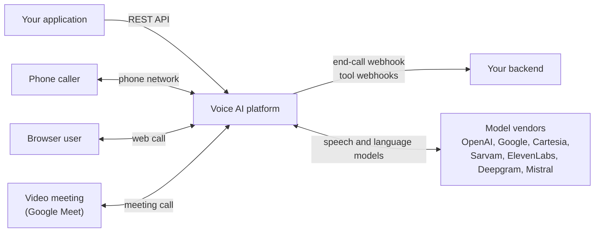
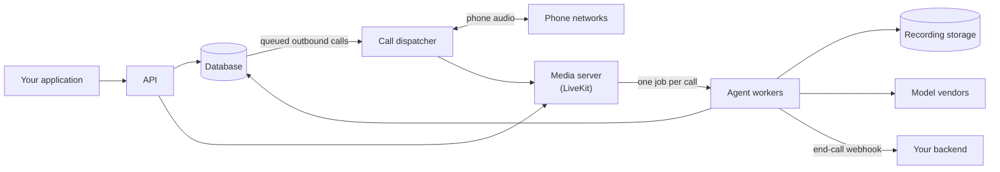
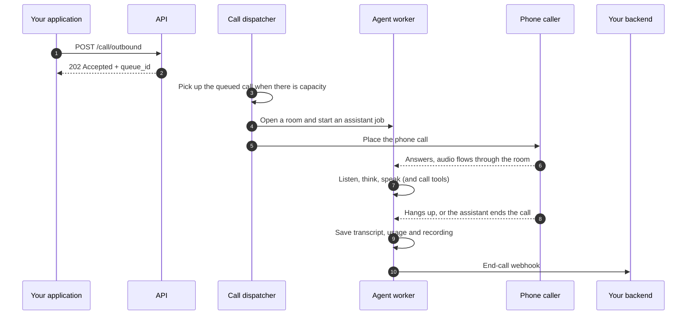

# How it works

This page gives you the whole picture before the details: who and what the platform talks to,
the parts it is made of, and what happens during one call. Each part links to a page that goes
deeper.

## The platform and the world around it

You build an **assistant** (its instructions, voice, models and tools) through the API, then
start calls with it. The platform connects that assistant to people and reports back to you.

| Who or what | How it connects |
|---|---|
| **Your application** | Calls the REST API with your API key: creates assistants, starts calls, reads call records and usage. |
| **Phone callers** | Reach the assistant through a phone network. Outbound calls go through Twilio or Exotel; inbound calls come in through Exotel. |
| **Browser users** | Join a web call from your page, by voice, by text, or both. |
| **Meeting participants** | Hear and talk to the assistant inside a video meeting. See [Meeting calls](meeting-calls.md). |
| **Your backend** | Receives the end-call webhook when a call finishes, and the tool webhooks your assistant calls during a conversation. |
| **Model vendors** | Turn speech into text, decide what to say, and turn the reply back into speech. Which vendors a call uses depends on the assistant's mode and configuration. |

## The parts inside the platform

| Part | What it does for you |
|---|---|
| **API** | Checks every request, rejects an assistant configuration that could not run, starts web and meeting calls straight away, and puts outbound phone calls in a queue. |
| **Call dispatcher** | Works through the outbound queue at the pace capacity allows, places the phone call, and answers inbound phone calls. Tries each dispatch up to three times before marking the call `failed`. |
| **Media server** | Every call is a private **room**. The person (or the phone line, or the meeting) and the assistant are the two parties in it. |
| **Agent workers** | Run the conversation: listen, think, speak, call your tools, keep the transcript, measure usage, and send the end-call webhook. |
| **Database** | Holds assistants, tools, the outbound queue, call records, transcripts and usage. |
| **Recording storage** | Holds call recordings and the audio files you upload for prerecorded greetings. |

How the assistant listens and speaks inside a call depends on its mode; see
[Assistant modes](assistant-modes.md).

## The life of one call

An outbound phone call, end to end:

Web and meeting calls skip the queue: the API opens the room and starts the assistant job
directly, and you get the room details back in the response. Inbound phone calls start when the
call arrives. Every call type ends the same way, with a finished call record and one end-call
webhook. The states a call moves through are on [Call lifecycle](call-lifecycle.md).

## Read next

- [Assistant modes](assistant-modes.md): pipeline, realtime, cascade and duplex, and what each one
  costs in latency and money.
- [Cascade](cascade.md): separate speech-to-text, language model and text-to-speech stages.
- [Duplex](duplex.md): a model that listens while it speaks.
- [Call lifecycle](call-lifecycle.md): queue states, call states, capacity and retries.
- [Meeting calls](meeting-calls.md): putting an assistant into a video meeting.
- [Build a meeting connector](../guides/meeting-connector.md): the contract a worker implements to bring an assistant into another meeting platform.
- [Compatibility matrix](../reference/compatibility.md): which combinations of mode and models are
  allowed.
- [End-call webhook](../api/calls/webhook.md): what your backend receives when a call ends.
