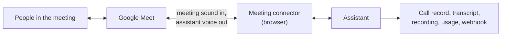
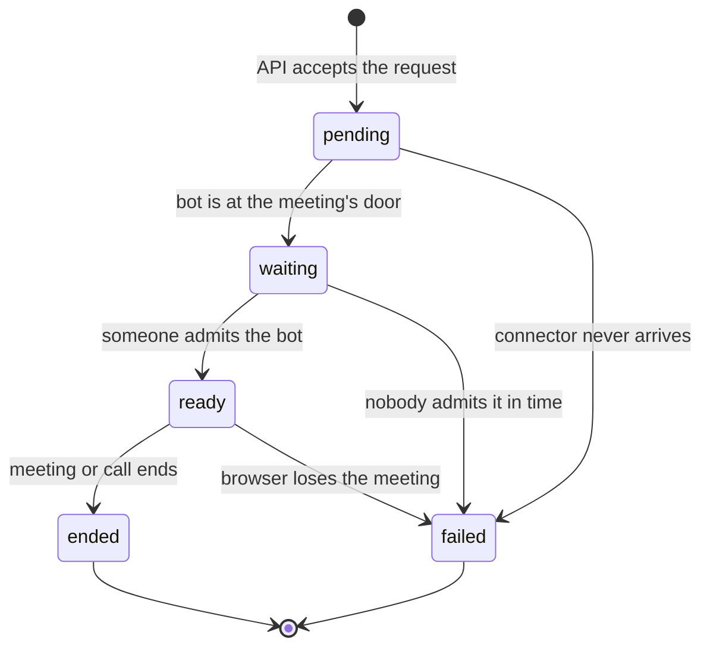

# Meeting calls

A meeting call puts your assistant into a video meeting as an ordinary participant. It joins
under a display name you choose, hears everyone in the meeting, and speaks back into it. Google
Meet is the supported platform.

To start one, call [`POST /meeting_call/join`](../api/calls/meeting-call.md) with the assistant
and the meeting link. The call record, transcript, usage and end-call webhook work exactly as they
do for a web call.

## What joins the meeting

Two things run for every meeting call, side by side:

- **The assistant**, which runs the conversation exactly as in any other call.
- **A meeting connector**, a browser that joins the meeting on the assistant's behalf. It carries
  the meeting's sound to the assistant and plays the assistant's voice into the meeting. It does
  no thinking of its own.

The assistant hears **one mix of the whole meeting**, not a separate stream per person. That is
what lets it follow a conversation with several people. The trade-off: the transcript records what
was said in the meeting, but not which person said each sentence. People who join after the bot
are heard as soon as they join.

## Lifecycle

The call record shows these steps in two places. `meeting_connector_status` follows the
connector (`pending`, `waiting`, `ready`, `failed`, `ended`), and `call_status` follows the call:

| Connector state | What it means | `call_status` |
|---|---|---|
| `pending` | The request was accepted and the connector is starting. | `initiated` |
| `waiting` | The bot asked to join and is in the meeting's waiting room. | `initiated` |
| `ready` | The bot is in the meeting and audio flows both ways. | `answered`, with `answered_at` set |
| `failed` | The connector could not join or lost the meeting. | `failed`, with the reason in `call_status_reason` |
| `ended` | The meeting ended or the bot left. | `completed` once the call is finalized |

The record also keeps `meeting_connector_ready_at`, `meeting_connector_ended_at` and
`meeting_connector_status_reason`.

### Admitting the bot

Most meetings hold an outside participant in a waiting room until a host lets them in. **Someone
in the meeting has to admit the bot.** Until they do, the assistant waits silently: it does not
greet, and nothing is recorded.

Two time limits bound that wait:

| Limit | Default | What it covers |
|---|---|---|
| Connector arrives | 2 minutes | The connector must start and reach the call. No human is involved, so a miss here means the platform had no free connector. |
| Bot admitted | 6 minutes | The connector must get into the meeting, including the time a host takes to admit it. The connector itself gives up after about 5 minutes in the waiting room and reports why. |

When the bot is admitted, the assistant greets the meeting (if the assistant is set to speak
first) and the call begins.

## What is recorded and billed

- **Recording** starts when the bot is admitted, not when you made the request, so the file has
  no waiting-room silence at the start. It captures both the meeting and the assistant. A bot that
  is never admitted produces no recording.
- **Call duration** runs from `answered_at` (the moment the bot was admitted) to the end of the
  call. A call that ends `failed` has `billable_duration_minutes` of `0`.
- **Usage** (model tokens and speech seconds) is measured the same way as on any call. See
  [Usage accounting](../reference/usage-accounting.md).

## Capacity

Meeting calls have their own concurrency limit, separate from phone and web calls, because each
one holds a whole browser. When the limit is reached the API answers `503`; retry shortly. See
[Join a meeting](../api/calls/meeting-call.md#capacity).

## How a meeting call ends

| What happened | `call_status` | `call_status_reason` or `call_end_reason` |
|---|---|---|
| The platform could not start the call | `failed`, and the API answers `500` | Your end-call webhook still fires, so you learn the call will not happen. |
| The connector never reached the call | `failed` | `Meeting connector did not join the room` |
| Nobody admitted the bot in time | `failed` | `Meeting connector readiness timed out`, or the connector's own reason if it gave up first |
| The connector lost the meeting | `failed` | The connector's reason |
| The meeting ended | `completed` | |
| The assistant said goodbye (its end-call tool) | `completed` | `call_end_reason`: `end_call_tool` |
| Nobody spoke and the assistant ran out of re-prompts | `completed` | `call_end_reason`: `silence_timeout` |
| The call reached `max_call_duration_minutes` | `completed` | `call_end_reason`: `max_duration_exceeded` |

In every case the bot leaves the meeting, the call record is finalized, and your backend gets one
[end-call webhook](../api/calls/webhook.md).

If the meeting cannot hear the assistant even though the call shows `answered`, see
[Troubleshooting](../reference/troubleshooting.md#a-meeting-call-is-silent-but-tokens-are-still-billed).

## Bringing your own connector

The platform runs the assistant side of a meeting call. The connector is a separate worker with a
published contract, so one can be built for another meeting platform. See
[Build a meeting connector](../guides/meeting-connector.md).
